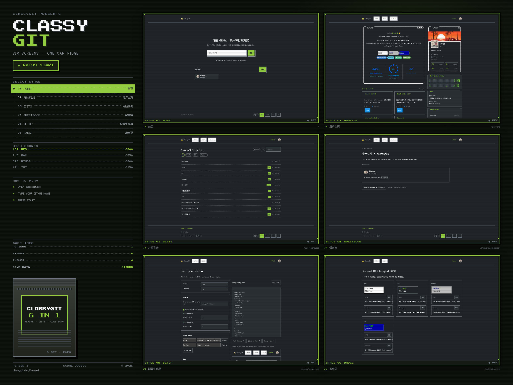
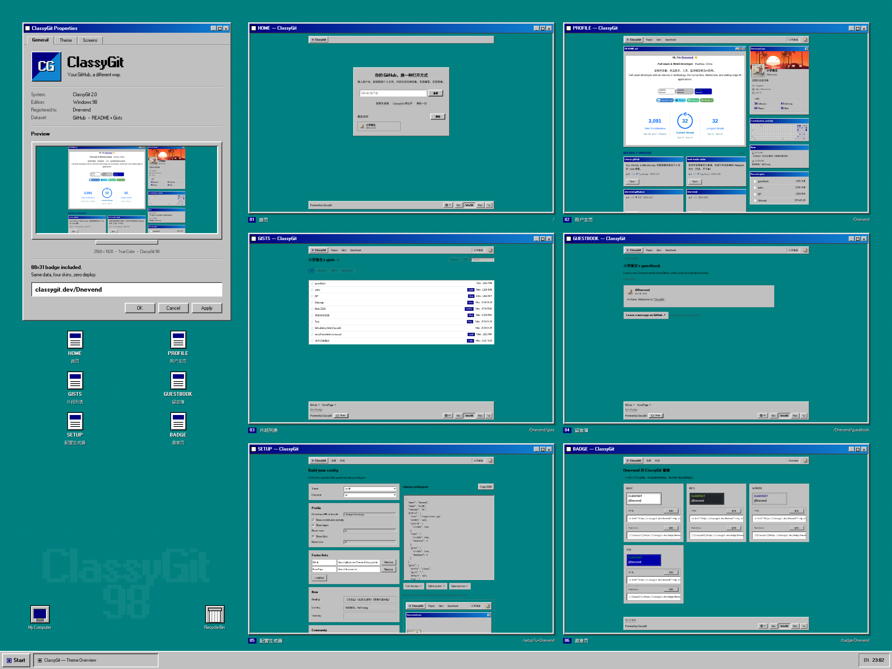

<h1 align="center">ClassyGit</h1>

<p align="center"><strong>Your GitHub, a different way.</strong></p>

<p align="center">
  <a href="https://classygit.dev"></a>
</p>

<p align="center">
  <a href="https://classygit.dev" target="_blank"><strong>Live demo</strong></a> ·
  <a href="#get-started-in-3-minutes"><strong>3-minute setup</strong></a> ·
  <a href="https://classygit.dev/setup" target="_blank"><strong>Config builder</strong></a> ·
  <a href="./README.md">中文</a>
</p>

<p align="center">
  <a href="https://github.com/Dnevend/classy-github/blob/main/LICENSE"></a>
  <a href="https://astro.build"></a>
  <a href="https://workers.cloudflare.com"></a>
  <a href="https://github.com/Dnevend/classy-github/pulls"></a>
  <a href="https://github.com/Dnevend/classy-github"></a>
</p>

No deploy, no login, no server: turn GitHub into your retro personal homepage + blog. Try it now at [classygit.dev](https://classygit.dev).

<table>
  <tr>
    <td width="50%" align="center">
      <a href="https://classygit.dev/Dnevend?theme=mac"></a>
      <br><sub><code>mac</code> · System 6</sub>
    </td>
    <td width="50%" align="center">
      <a href="https://classygit.dev/Dnevend?theme=nes"></a>
      <br><sub><code>nes</code> · 8-bit</sub>
    </td>
  </tr>
  <tr>
    <td width="50%" align="center">
      <a href="https://classygit.dev/Dnevend?theme=win98"></a>
      <br><sub><code>win98</code> · Windows 98</sub>
    </td>
    <td width="50%" align="center">
      <a href="https://classygit.dev/Dnevend?theme=tui"></a>
      <br><sub><code>tui</code> · DOS</sub>
    </td>
  </tr>
</table>

## Why ClassyGit

ClassyGit is not another static blog generator. It does not host your content, and it does not ask you to move your posts: it renders the public data you already have on GitHub — your profile README, repositories, Gists and Gist comments — as a personal homepage + blog.

- **No deploy**: fork the repo, edit one `classy.config.json`, and it goes live within 5 minutes. No build, no CI, no publish button.
- **No login**: visitors just open the link. Site owners do not need a ClassyGit account either; the config is a file on GitHub.
- **No server to buy**: content lives on GitHub and pages are rendered at Cloudflare's edge. No VPS, database or object storage to maintain.

> **Your content is not in a ClassyGit database. It stays on your GitHub. ClassyGit is just a replaceable skin.** Even if this public instance disappears one day, your README, repositories, Gists and comments are still on GitHub. The code is MIT, so you can point another instance at it or self-host.

It is for people who want a homepage without maintaining a server, people who already write READMEs and keep notes in Gists, and people who like System 6, 8-bit, Windows 98 or DOS aesthetics.

## Get started in 3 minutes

1. **Fork**: [Dnevend/classy-github](https://github.com/Dnevend/classy-github/fork). Keep the repository name `classy-github`.
2. **Build your config**: open [`/setup?u=your-username`](https://classygit.dev/setup), fill the form and copy the JSON into `classy.config.json` in the root of your fork. Set `owner` to your GitHub username.
3. **Wait 5 minutes**: open [`https://classygit.dev/your-username`](https://classygit.dev/). The page refreshes within 5 minutes.

## What you get

- **Your README is the homepage**: renders your GitHub profile README with Markdown, syntax highlighting and relative images; the profile card, contribution wall, recent repos, recent Gists and Now card are generated for you.
- **Gists are your blog**: write `classy.blog.title #tag` in a Gist description (type names use Latin letters) and it becomes the type, title and tags. Multi-file posts, reading time, monthly archive and tag filtering included.
- **Four retro themes**: `mac`, `nes`, `win98` and `tui` share the same data. Site owners set the default in the config.
- **Sharing built in**: themed share card with a QR code, 1200×630 OG images, 88×31 badges, an Atom feed and a sitemap. Claimed sites are indexed by search engines by default.
- **Guestbook and webring**: use a public Gist's comments as a guestbook, and hop between retro sites with “previous / random / next” footer links.
- **Fast, clean and replaceable**: server-rendered HTML with edge caching; no IPs stored and no profiling; content stays on GitHub, so you can switch instances or self-host anytime.

<details>
<summary>All routes</summary>

| Route | What you see |
|---|---|
| `/<username>` | README, profile card, follower counts, contribution wall, recent repos, recent Gists, Now |
| `/<username>/repos` | All public repositories, with search and pagination |
| `/<username>/repo/<repo>` | Repository README |
| `/<username>/gists` | Public Gists (up to 100), with tag filter and search |
| `/<username>/gist/<id>` | Article view: Markdown, syntax highlighting, reading time, multiple files |
| `/<username>/archive` | Gists grouped by month (up to 100 Gists) |
| `/<username>/guestbook` | Guestbook powered by Gist comments |
| `/<username>/rss.xml` | Atom feed (latest 50 Gists) |
| `/webring` | Webring directory |
| `/random` | Jump to a random site |
| `/badge/<username>` | 88×31 badge generator |
| `/setup?u=<username>` | Config builder with live preview |
| `/claim/<username>` | Three-step claim page with a starter config |

</details>

## Community

ClassyGit is not a single homepage; it is a ring of retro sites that can visit each other.

| Feature | What it does | How to enable |
|---|---|---|
| Webring | Footer “previous / random / next”, with `/webring` as the directory | On by default, `webring.enabled` |
| Random discovery | `/random` jumps to a random site | On by default, `discover.enabled` |
| Guestbook | Public Gist comments as a guestbook | `guestbook.gistId` |
| Visitor counter | Footer “{count} visitors”, no IP stored | Automatic after claiming |
| 88×31 badge | A tiny four-theme badge for READMEs and blogrolls | `/badge/<username>` |

<details>
<summary>How to enable the webring and guestbook</summary>

**Webring**: joining adds your site to the `/webring` directory. Once the ring has at least 3 members, the footer shows “← previous / 🎲 / next →”. Set `enabled` to `false` to opt out.

```json
{
  "webring": { "enabled": true },
  "discover": { "enabled": true }
}
```

**Guestbook**: create a **public** Gist with the description `classy.guestbook`, then put its Gist ID into the config. Visitors comment on GitHub; the site renders comments read-only. To delete a comment, delete it on the Gist. The Gist must be public and owned by you, otherwise the site refuses to render it.

```json
{
  "guestbook": { "gistId": "9ec0af30..." }
}
```

Posting a comment requires a GitHub account — it reuses GitHub identity, so there is no extra password to manage. Images and embeds in comments are stripped to avoid tracking pixels.

</details>

## Configuration

The recommended path is the form builder at [`/setup?u=<username>`](https://classygit.dev/setup); you can also edit `classy.config.json` directly in the root of your fork. The repository name must be `classy-github`, and `owner` must be your GitHub username — if you keep the author's `owner`, the file is treated as a template and ignored.

Common changes:

| Goal | Change |
|---|---|
| Change the default theme | `"theme": "nes"` (`mac` / `nes` / `win98` / `tui`) |
| Share a specific theme | Add `?theme=nes` to the URL |
| Default to Chinese | `"language": "zh"` |
| Add a cover image | `"profile": { "cover": "/images/cover.jpg" }` or any http(s) image |
| Hide the contribution wall | `"profile": { "contrib": { "visible": false } }` |
| Change repo / Gist preview counts | `"profile": { "repos": { "showCount": 6 }, "gists": { "showCount": 6 } }` |
| Add footer links / fill the Now card | `"links": [{ "title": "Blog", "href": "https://…" }]`, `"now": { "books": ["…"] }` |
| Enable the guestbook | `"guestbook": { "gistId": "…" }` |
| Join the webring / allow random discovery | `"webring": { "enabled": true }`, `"discover": { "enabled": true }` |
| Opt out of search indexing | `"seo": { "index": false }` |
| Add header links | `"nav": { "extra": [{ "title": "…", "href": "https://…" }] }` (mac / win98 themes) |

<details>
<summary>Full config example, field reference and fallback behavior</summary>

```json
{
  "owner": "your-login",
  "theme": "mac",
  "language": "en",
  "profile": {
    "cover": "https://example.com/cover.jpg",
    "cardUrl": null,
    "contrib": { "visible": true },
    "repos": { "visible": true, "showCount": 6 },
    "gists": { "visible": true, "showCount": 6 }
  },
  "gists": {
    "prefix": "classy",
    "split": ".",
    "default": null,
    "type": [{ "name": "blog" }, { "name": "code" }]
  },
  "links": [
    { "title": "GitHub", "href": "https://github.com/your-login" },
    { "title": "Blog", "href": "https://example.com" }
  ],
  "nav": {
    "extra": [{ "title": "About", "href": "https://example.com/about" }]
  },
  "now": {
    "books": ["The Psychology of Money"],
    "music": ["Ryuichi Sakamoto - async"],
    "watching": []
  },
  "guestbook": { "gistId": null },
  "webring": { "enabled": true },
  "discover": { "enabled": true },
  "seo": { "index": true }
}
```

| Field | Default | Description |
|---|---|---|
| `owner` | `null` | GitHub username that owns the config. If it does not match the current user, the whole file is ignored as a template; an empty or invalid value is accepted as a legacy config. |
| `theme` | `mac` | Default theme: `mac` / `nes` / `win98` / `tui`, used when a visitor has no `?theme=` or cookie. |
| `language` | `en` | Site default language: `en` / `zh`. Used when a visitor has no `?lang=`, no language cookie, and no `en` / `zh` in `Accept-Language`. |
| `profile.cover` | `null` | Profile card cover image; when unset, a themed default banner is shown. Accepts an http(s) image or a site path. |
| `profile.cardUrl` | `null` | Third-party stats image at the bottom of the Now card, e.g. an SVG generated by an Action. |
| `profile.contrib.visible` | `true` | Show the contribution wall. |
| `profile.repos.visible` | `true` | Show recent repositories on the profile. |
| `profile.repos.showCount` | `6` | Number of repositories on the profile, 0–100. |
| `profile.gists.visible` | `true` | Show recent Gists on the profile. |
| `profile.gists.showCount` | `6` | Number of Gists on the profile, 0–100. |
| `gists.prefix` | `classy` | Gist description prefix; the default rule is `classy.blog.title #tag`. |
| `gists.split` | `.` | Separator between prefix, type and title. |
| `gists.default` / `gists.type` | — | Legacy compatibility fields; unused by the current version. |
| `links` | `[]` | Footer links, each `{ "title", "href" }`; http(s) only, title up to 64 characters. |
| `nav.extra` | `[]` | Extra header links, up to 5; currently rendered only by the `mac` / `win98` themes. |
| `now.books` / `music` / `watching` | `[]` | Now card; up to 8 items each, 80 characters per item. |
| `guestbook.gistId` | `null` | A public Gist ID owned by you (20–40 hex characters); `null` disables the guestbook. |
| `webring.enabled` | `true` | Join the webring; footer links appear once the ring has at least 3 members. |
| `discover.enabled` | `true` | Allow `/random` to recommend your site. |
| `seo.index` | `true` | Allow search engines to index the profile (claimed sites only); theme variants chosen by a visitor stay `noindex`. |

**If the config is wrong**: each section is validated independently, so a broken section falls back to defaults and the rest still applies; `links` are validated one by one, so a bad link is dropped; unknown fields are discarded; an unknown theme falls back to `mac`, and an unknown language falls back to `en`.

</details>

## How it works

```text
GitHub                          Cloudflare
┌──────────────────────┐        ┌───────────────────────────────┐
│ README / repos       │        │ Astro SSR on Workers          │
│ Gists / comments     │ ─────► │ edge cache + KV + Durable OBJ │
│ classy.config.json   │  API   │ no database for content       │
└──────────────────────┘        └──────────────┬────────────────┘
                                                │
                                                ▼
                                 classygit.dev/<username>
```

- **GitHub is the source of content and identity**: README, repositories, Gists and comments live there; ClassyGit does not copy or host them.
- **Cloudflare only renders, caches and counts**: Workers run Astro SSR, KV stores the webring / random list / indexable users, and Durable Objects store visitor counts.
- **No content database**: even if the Cloudflare-side KV and DO data were lost, your content would not be — the next visit rebuilds it from GitHub.

## FAQ

<details>
<summary><strong>Do I need my own server or domain?</strong></summary>

No. The public instance gives you `https://classygit.dev/<username>`. Self-host if you want your own domain.
</details>

<details>
<summary><strong>Do I need to log in?</strong></summary>

Not to browse, and site owners do not need a ClassyGit account either — just a GitHub account to host the config. Posting a guestbook comment requires a GitHub account because comments are Gist comments.
</details>

<details>
<summary><strong>Can the site go down? Will my content be lost?</strong></summary>

Your content stays on GitHub; the site is only a renderer. There is no server to expire and no content database to lose. Even if this public instance stops, your README, repositories, Gists and comments remain on GitHub. The code is MIT; switch to another instance or self-host and keep going.
</details>

<details>
<summary><strong>How long do README / repository changes take?</strong></summary>

Config changes (theme, links, Now) appear within 5 minutes. README, repository and Gist lists are cached for up to 30 minutes to survive launch traffic and crawlers. To verify a config change immediately, open `?preview=1` from this site.
</details>

<details>
<summary><strong>Will GitHub API rate limits break it?</strong></summary>

The production instance uses a server-side GitHub token plus edge caching, and blocks AI crawlers at the Worker. If the quota is genuinely exhausted, it serves cached HTML (up to 24 hours old, marked `x-classy-stale`) instead of an error page.
</details>

<details>
<summary><strong>Can I use it as a blog? Does it support private content?</strong></summary>

Yes. Public Gists are your posts, with Markdown, syntax highlighting, tags, an archive, reading time and an Atom feed. It only reads public data; private repositories and secret Gists are never shown.
</details>

## Development

Requires Node 22+ and pnpm 9+.

```bash
git clone https://github.com/Dnevend/classy-github.git
cd classy-github
pnpm install
pnpm dev            # http://localhost:4321
```

Before submitting changes, run `pnpm check`, `pnpm test` and `pnpm build`. Issues and PRs are welcome.

## Share ClassyGit

If this project makes you want to redecorate your GitHub, [star the repository](https://github.com/Dnevend/classy-github) or send it to the friend who has been “about to start a blog” for years. You can also [share it on X](https://twitter.com/intent/tweet?text=ClassyGit%20%E2%80%94%20turn%20your%20GitHub%20into%20a%20retro%20personal%20homepage%20%2B%20blog.&url=https%3A%2F%2Fclassygit.dev).

Put the badge in your README or blogroll:

```md
[](https://classygit.dev/your-username)
```

[](https://classygit.dev/badge/Dnevend)

<details>
<summary>See the OG preview</summary>


</details>

## License

Code is released under [MIT](./LICENSE). Bundled fonts and third-party styles keep their own licenses: Fusion Pixel Font and Press Start 2P (OFL-1.1); 98.css, NES.css and TuiCss (MIT).
