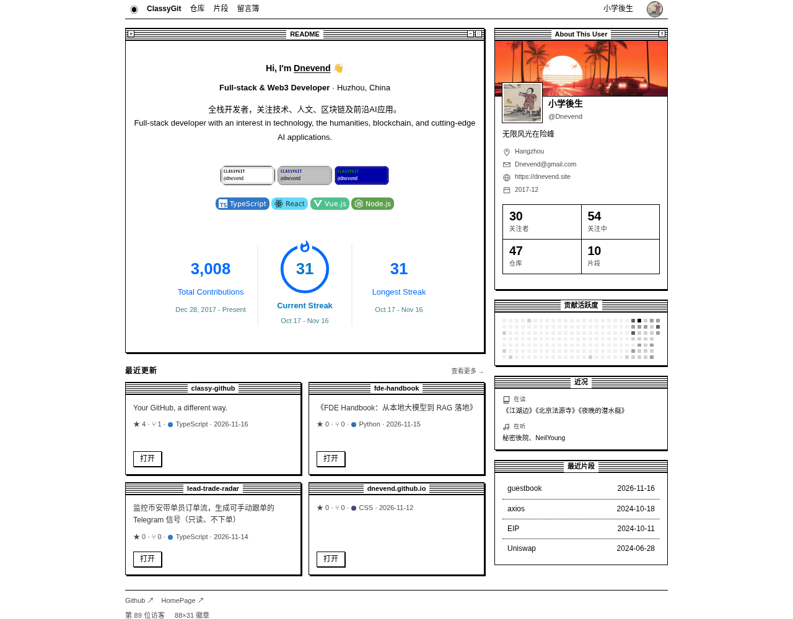
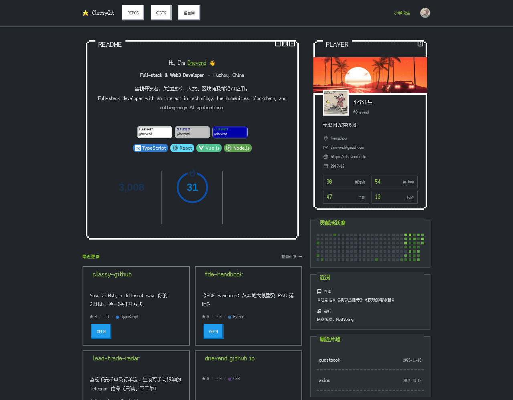
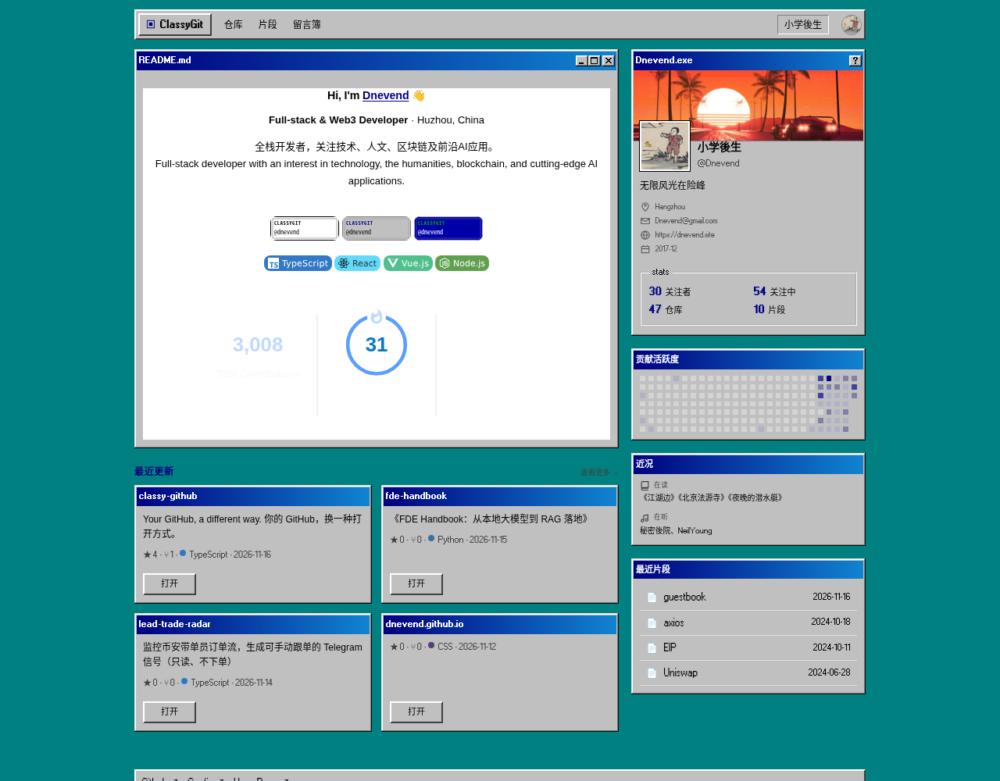
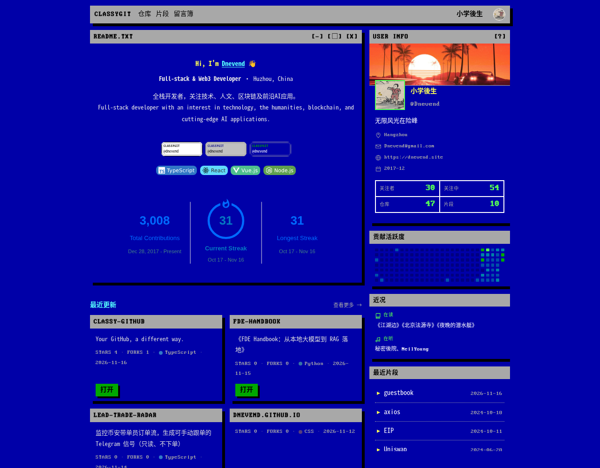

# ClassyGit

**Your GitHub, a different way.**

No deploy, no login, no server to buy: turn your README, repositories and Gists into a retro personal homepage + blog.

<p align="center">
  <a href="https://classygit.dev/Dnevend"><strong>Live demo</strong></a> ·
  <a href="#get-started-in-3-minutes"><strong>3-minute setup</strong></a> ·
  <a href="https://classygit.dev/setup"><strong>Config builder</strong></a> ·
  <a href="#themes"><strong>Themes</strong></a> ·
  <a href="https://github.com/Dnevend/classy-github"><strong>GitHub</strong></a> ·
  <a href="./README.md">中文</a>
</p>

Four themes, one GitHub dataset. Click a screenshot to open that theme live:

| `mac` · System 6 | `nes` · 8-bit |
|---|---|
| [](https://classygit.dev/Dnevend?theme=mac) | [](https://classygit.dev/Dnevend?theme=nes) |
| **`win98` · Windows 98** | **`tui` · DOS** |
| [](https://classygit.dev/Dnevend?theme=win98) | [](https://classygit.dev/Dnevend?theme=tui) |

<p align="center"><sub>mac / nes / win98 / tui · screenshots from <a href="https://classygit.dev/Dnevend">Dnevend's profile</a></sub></p>

**Contents**: [Why](#why-classygit) · [Start](#get-started-in-3-minutes) · [Features](#what-you-get) · [Themes](#themes) · [Community](#community) · [Config](#configuration) · [FAQ](#faq) · [Self-host](#development-and-self-hosting)

## Why ClassyGit

ClassyGit is not another static blog generator. It does not host your content, and it does not ask you to move your posts: it renders the public data you already have on GitHub — your profile README, repositories, Gists and Gist comments — as a personal homepage + blog.

Unlike GitHub Pages: there is no site project to maintain and no build step per post. You edit content that already lives on GitHub; ClassyGit renders it.

| No deploy | No login | No server to buy |
|---|---|---|
| Fork the repo, edit one `classy.config.json`, and it goes live within 5 minutes. No build, no CI, no publish button. | Visitors just open the link. Site owners do not need a ClassyGit account either; the config is a file on GitHub. | Content lives on GitHub and pages are rendered at Cloudflare's edge. No VPS, database or object storage to maintain. |

> **Your content is not in a ClassyGit database. It stays on your GitHub. ClassyGit is just a replaceable skin.**
>
> No server renewal, no database loss, no platform lock-in. Even if this public instance disappears one day, your README, repositories, Gists and comments are still on GitHub. The code is MIT, so you can point another instance at it or self-host.

At runtime there are only two external dependencies: **GitHub provides content and identity, Cloudflare provides compute, caching and counters**. No auth service, no personal server bill. The repo loads no analytics scripts by default; the author's instance optionally enables cookieless Cloudflare Web Analytics.

**Who is it for?**

- People who want a personal homepage or blog without maintaining a server, domain and build pipeline
- People who already write READMEs and keep notes in Gists, and want a better-looking front door
- People who like System 6, 8-bit, Windows 98 or DOS aesthetics
- People who want to hop between independent sites and trade 88×31 badges

## Get started in 3 minutes

1. **See it first**: open [classygit.dev/Dnevend](https://classygit.dev/Dnevend), or enter any GitHub username on the landing page. Any public GitHub account gets a page immediately — no fork required.
2. **Fork the repo**: [Dnevend/classy-github](https://github.com/Dnevend/classy-github/fork). Keep the repository name `classy-github` (the default fork name).
3. **Build your config**: open [`/setup?u=your-username`](https://classygit.dev/setup), fill the form and copy the JSON; or edit `classy.config.json` directly in the root of your fork. Set `owner` to your GitHub username.
4. **Wait 5 minutes**: open `https://classygit.dev/your-username`. The page refreshes within 5 minutes. No build, deploy or CI.

> Regular users do not need `pnpm install`, a Cloudflare account or a domain. Those are only for changing the code or self-hosting — see the end of this README.

## What you get

### Page map

| Route | What you see |
|---|---|
| `/<username>` | README, profile card, follower counts, contribution wall, recent repos, recent Gists, Now |
| `/<username>/repos` | All public repositories, with search and pagination |
| `/<username>/repo/<repo>` | Repository README |
| `/<username>/gists` | Public Gists (up to 100), with tag filter and search |
| `/<username>/gist/<id>` | Article view: Markdown, syntax highlighting, reading time, multiple files |
| `/<username>/archive` | Gists grouped by month (up to 100 Gists) |
| `/<username>/guestbook` | Guestbook powered by Gist comments |
| `/<username>/rss.xml` | Atom feed (latest 50 Gists) |
| `/webring` | Webring directory |
| `/random` | Jump to a random site |
| `/badge/<username>` | 88×31 badge generator |
| `/setup?u=<username>` | Config builder with live preview |
| `/claim/<username>` | Three-step claim page with a starter config |

### Profile

- **Your README is the homepage**: renders your GitHub profile README, keeps Markdown, syntax highlighting and relative images; generates a starter README if you do not have one.
- **Profile card**: avatar, name, bio, location, company, email, website, X and join date; add a custom cover image, or let the themed default banner fill in when there is none.
- **At a glance**: followers / following / repos / Gists, plus a contribution wall themed to match.
- **Recently updated**: repositories sorted by update time; open one to read its README.
- **Now**: reading / listening / watching, plus an optional third-party stats card.
- **Claim banner**: pages without a config show a “make it yours” banner that leads to a three-step claim page.

### Content and blog

- **Repository list**: every public repository, with search and pagination.
- **Gists as a CMS**: write `classy.blog.title #tag` in a Gist description; it becomes the type, title and tags. Type names use Latin letters (e.g. `blog` / `code` / `note`); prefix and separator are configurable.
- **Tags, archive, reading time**: filter by tag, browse by month, and show an estimated reading time on article pages.
- **Multi-file Gists**: every file is rendered independently; Markdown goes through the same pipeline and code is highlighted server-side with Shiki (21 common languages).
- **Atom feed**: `/<username>/rss.xml` returns the latest 50 Gists as an Atom feed, with auto-discovery wired into `<head>`. The Gist list and archive read at most 100 Gists.

### Sharing

- **Themed share cards**: the footer “Share” button generates a 1200px-wide themed PNG with a QR code; save it, copy the link, or share to X. The card follows the current theme.
- **OG images**: `/og/<username>.png` returns a 1200×630 themed social card, so link previews show more than an avatar.
- **88×31 badges**: four theme palettes; copy HTML or Markdown and drop it into a README, blog or blogroll.
- **SEO**: server-rendered title, description, canonical and JSON-LD; indexing is off by default and `seo.index: true` opts in. The default theme page is `index`; theme variants chosen by a visitor stay `noindex`.
- **Sitemap / robots**: user pages are listed only when `seo.index` is enabled; the landing page and webring are always included.

### Experience and performance

- **Four themes**: `mac` (System 6), `nes` (8-bit), `win98`, `tui` (DOS). Site owners set the default in config; visitors can switch with `?theme=` or the footer, and a cookie remembers it. Each theme ships its own CSS, and only the current one is loaded.
- **Bilingual**: English / Chinese. Site owners set the default language; visitors can switch in the footer or with `?lang=zh`.
- **Mobile**: all four themes were checked at 375px wide with no horizontal overflow; the main column collapses to a single column.
- **Recent visits**: the landing page remembers profiles viewed on this device (localStorage, never uploaded).
- **Edge cache**: profile pages for 5 minutes, articles for 1 hour, badges and OG images for 1 day. Cache keys include theme and language, so a NES page is never served to a mac visitor. If upstream returns 5xx or hits a rate limit, the last cached HTML (up to 24 hours old) is served instead of an error page.
- **Server-side rendering**: complete HTML in the first response, readable by crawlers and link previews.

### Security and privacy

- **The app stores no IPs and does no profiling**. No analytics scripts are loaded by default; the author's instance optionally enables cookieless Cloudflare Web Analytics (controlled by `PUBLIC_CF_ANALYTICS_TOKEN`).
- The app uses only two functional cookies: theme and language.
- READMEs, Gists and guestbook comments go through a `rehype-sanitize` allowlist; `javascript:` links are dropped.
- The guestbook only renders comments from a public Gist and strips images/embeds to avoid tracking pixels.
- External links use `rel="noopener noreferrer"`.

## Themes

All four themes share the same data; the theme only changes the shell.

- The default theme comes from `classy.config.json` (`mac` if omitted); the old `?theme=default` link maps to `mac`, and `?theme=win95` maps to `win98`.
- Theme priority: `?theme=` > cookie > configured `theme` > `mac`.
- Each theme is a separate CSS bundle; a visitor on `mac` does not download the 279KB NES stylesheet.
- With no cover configured, each theme renders its own default banner (checkerboard / pixel grid / DOS scanlines / teal desktop).
- Share cards, OG images and badges follow the theme palette.

## Community

ClassyGit is not a single homepage; it is a ring of retro sites that can visit each other.

| Feature | What it does | How to enable |
|---|---|---|
| Webring | Footer “previous / random / next”, with `/webring` as the directory | On by default, `webring.enabled` |
| Random discovery | `/random` jumps to a random site | On by default, `discover.enabled` |
| Guestbook | Public Gist comments as a guestbook | `guestbook.gistId` |
| Visitor counter | Footer “{count} visitors”, no IP stored | Automatic after claiming |
| 88×31 badge | A tiny four-theme badge for READMEs and blogrolls | `/badge/<username>` |

### Webring and random discovery

```json
{
  "webring": { "enabled": true },
  "discover": { "enabled": true }
}
```

- Joining adds your site to the `/webring` directory and shows “← previous / 🎲 / next →” in the footer.
- The footer widget stays hidden until the ring has at least 3 members, so you never see a ring with only yourself.
- `discover` allows `/random` to send visitors to your page. Set `enabled` to `false` to opt out.
- After a config change, your profile refreshes within 5 minutes; the webring title/theme syncs within 1 hour, and membership changes apply on the next profile refresh.

### Guestbook

Use the comments of a public Gist as a guestbook — zero backend, zero moderation dashboard:

1. Create a **public** Gist with the description `classy.guestbook`.
2. Put its Gist ID into `classy.config.json`:

```json
{
  "guestbook": { "gistId": "9ec0af30..." }
}
```

3. A “Guestbook” link appears in the header. Visitors comment on GitHub; the site renders comments read-only. To delete a comment, delete it on the Gist.

The Gist must be public and owned by you, otherwise the site refuses to render it. Images and embeds in comments are stripped to avoid tracking pixels. Posting a comment requires a GitHub account — it reuses GitHub identity, so there is no extra password to manage.

### Visitor counter

After claiming, the profile footer shows “{count} visitors”. Counts live in one Durable Object per user; the same tab session only counts once (a new tab counts again). No IP is stored and no profile is built. Bots and prefetches are read-only, so the number is approximate.

### 88×31 badge

Open the “88×31 badge” link in your profile footer, or go to `/badge/<username>`, to copy HTML or Markdown snippets. The badge is pure SVG and accepts `?theme=mac|nes|win98|tui`.

[](https://classygit.dev/badge/Dnevend)

## Configuration

### Three ways to configure

| Method | Best for | Entry point |
|---|---|---|
| Form builder (recommended) | First-time setup | [`/setup?u=<username>`](https://classygit.dev/setup) |
| Claim page | Seeing the steps first | `/claim/<username>` |
| Edit directly | People comfortable with JSON | `classy.config.json` in your fork |

The config builder only generates JSON. It does not request GitHub authorization and never writes to your repository.

### Where the config lives

- Repository: `<your-username>/classy-github` — **the repository name must be `classy-github`** (the default fork name).
- File: `classy.config.json` in the root of the default branch. The branch can be `main`, `master` or anything else.
- Refresh: the profile updates within 5 minutes. No build, deploy or CI.
- Ownership: set `owner` to your GitHub username. If you fork and keep the author's `owner`, the file is treated as a template and ignored; an empty or invalid `owner` is accepted as a legacy config, which is not recommended.
- Preview: open it from `/setup`, or navigate to `https://classygit.dev/<your-username>?preview=1` from this site. Pasting the URL directly does not bypass the cache (so it cannot be used to burn quota).

### Minimal config

```json
{
  "owner": "your-login",
  "theme": "mac",
  "language": "en",
  "profile": {
    "cover": "https://example.com/cover.jpg",
    "repos": { "visible": true, "showCount": 6 },
    "gists": { "visible": true, "showCount": 6 }
  },
  "links": [
    { "title": "GitHub", "href": "https://github.com/your-login" }
  ],
  "guestbook": { "gistId": null },
  "webring": { "enabled": true },
  "discover": { "enabled": true },
  "seo": { "index": false }
}
```

> `theme` is the default skin for visitors who have not chosen one; to send visitors straight to a specific theme, share a `?theme=nes` link as well.

### Common changes

These are fragments; merge them into your JSON at the right level.

| Goal | Change |
|---|---|
| Change the default theme | `"theme": "nes"` (`mac` / `nes` / `win98` / `tui`) |
| Share a specific theme | Add `?theme=nes` to the URL (`mac` / `nes` / `win98` / `tui`) |
| Default to Chinese | `"language": "zh"` |
| Add a cover image | `"profile": { "cover": "https://…" }` |
| Hide the contribution wall | `"profile": { "contrib": { "visible": false } }` |
| Change repo / Gist preview counts | `"profile": { "repos": { "showCount": 6 }, "gists": { "showCount": 6 } }` |
| Add footer links | `"links": [{ "title": "Blog", "href": "https://…" }]` |
| Fill the Now card | `"now": { "books": ["…"], "music": ["…"], "watching": ["…"] }` |
| Enable the guestbook | `"guestbook": { "gistId": "…" }` |
| Join or leave the webring | `"webring": { "enabled": true }` |
| Allow random discovery | `"discover": { "enabled": true }` |
| Allow search indexing | `"seo": { "index": true }` |
| Add header links | `"nav": { "extra": [{ "title": "…", "href": "https://…" }] }` (mac / win98 themes) |

> `profile.gists` controls the “Recent Gists” preview on the profile. `gists` controls the Gist description rule. They are not the same thing.

### Full config example

```json
{
  "owner": "your-login",
  "theme": "mac",
  "language": "en",
  "profile": {
    "cover": "https://example.com/cover.jpg",
    "cardUrl": null,
    "contrib": {
      "visible": true
    },
    "repos": {
      "visible": true,
      "showCount": 6
    },
    "gists": {
      "visible": true,
      "showCount": 6
    }
  },
  "gists": {
    "prefix": "classy",
    "split": ".",
    "default": null,
    "type": [
      { "name": "blog" },
      { "name": "code" }
    ]
  },
  "links": [
    { "title": "GitHub", "href": "https://github.com/your-login" },
    { "title": "Blog", "href": "https://example.com" }
  ],
  "nav": {
    "extra": [
      { "title": "About", "href": "https://example.com/about" }
    ]
  },
  "now": {
    "books": ["The Psychology of Money"],
    "music": ["Ryuichi Sakamoto - async"],
    "watching": []
  },
  "guestbook": {
    "gistId": null
  },
  "webring": {
    "enabled": true
  },
  "discover": {
    "enabled": true
  },
  "seo": {
    "index": false
  }
}
```

> `gists.default` / `gists.type` are legacy compatibility fields; they do not affect rendering in the current version and are kept for old configs.

### Field reference

| Field | Default | Description |
|---|---|---|
| `owner` | `null` | GitHub username that owns the config. If it does not match the current user, the whole file is ignored as a template; an empty or invalid value is accepted as a legacy config. |
| `theme` | `mac` | Default theme: `mac` / `nes` / `win98` / `tui`. Used when a visitor has no `?theme=` or cookie; each theme loads its own CSS bundle. |
| `language` | `en` | Default language: `en` / `zh`. Visitors can override with `?lang=`. |
| `profile.cover` | `null` | Profile card cover image; when unset, a themed default banner is shown. http(s) only. |
| `profile.cardUrl` | `null` | Third-party stats image at the bottom of the Now card, e.g. an SVG generated by an Action. |
| `profile.contrib.visible` | `true` | Show the contribution wall. |
| `profile.repos.visible` | `true` | Show recent repositories on the profile. |
| `profile.repos.showCount` | `6` | Number of repositories on the profile, 0–100; out-of-range values are clamped. |
| `profile.gists.visible` | `true` | Show recent Gists on the profile. |
| `profile.gists.showCount` | `6` | Number of Gists on the profile, 0–100; out-of-range values are clamped. |
| `gists.prefix` | `classy` | Gist description prefix; the default rule is `classy.blog.title #tag` (type names use Latin letters). |
| `gists.split` | `.` | Separator between prefix, type and title. |
| `gists.default` | `null` | Compatibility field; currently unused by rendering. |
| `gists.type` | `blog` / `code` | Compatibility field; currently unused for filtering. |
| `links` | `[]` | Footer links; each item is `{ "title", "href" }`, http(s) only, title up to 64 characters. |
| `nav.extra` | `[]` | Extra header links, up to 5; currently rendered only by the `mac` / `win98` themes. |
| `now.books` / `music` / `watching` | `[]` | Now card; up to 8 items each, 80 characters per item. |
| `guestbook.gistId` | `null` | A public Gist ID owned by you (20–40 hex characters); `null` disables the guestbook. |
| `webring.enabled` | `true` | Join the webring; footer links appear once the ring has at least 3 members. |
| `discover.enabled` | `true` | Allow `/random` to recommend your site. |
| `seo.index` | `false` | Allow search engines to index the profile; the default theme page is `index`, while theme variants chosen by a visitor stay `noindex`. |

### What happens if the config is wrong

- Each section is validated independently: a broken section falls back to defaults, the rest still applies.
- `links` are validated one by one: a bad link is dropped, the rest stay.
- Unknown fields are discarded; `href` only accepts `http(s)`.
- An unknown theme falls back to `mac`; an unknown language falls back to `en`.
- Old links `?theme=default` map to `mac`, and `?theme=win95` maps to `win98`.

## How it works

```text
GitHub                          Cloudflare
┌──────────────────────┐        ┌───────────────────────────────┐
│ README / repos       │        │ Astro SSR on Workers          │
│ Gists / comments     │ ─────► │ edge cache + KV + Durable OBJ │
│ classy.config.json   │  API   │ no database for content       │
└──────────────────────┘        └──────────────┬────────────────┘
                                                │
                                                ▼
                                 classygit.dev/<username>
```

- **GitHub is the source of content and identity**: README, repositories, Gists and comments live there; ClassyGit does not copy or host them.
- **Cloudflare only renders, caches and counts**: Workers run Astro SSR, KV stores the webring / random list / indexable users, and Durable Objects store visitor counts.
- **No content database**: even if the Cloudflare-side KV and DO data were lost, your content would not be — the next visit rebuilds it from GitHub.
- **Edge cache**: the first request goes to GitHub, later ones hit Cloudflare's cache. Cache keys include theme and language, so themes never bleed into each other.
- **Per-theme bundles**: each theme ships its own CSS; a `mac` visitor does not download the 279KB NES stylesheet.

## FAQ

**Do I need my own server or domain?**
No. The public instance gives you `classygit.dev/<username>`. Self-host if you want your own domain.

**Do I need to log in?**
Not to browse, and site owners do not need a ClassyGit account either — just a GitHub account to host the config. Posting a guestbook comment requires a GitHub account because comments are Gist comments; it reuses GitHub identity instead of adding another password.

**Can the site go down? Will my content be lost?**
Your content stays on GitHub; the site is only a renderer. There is no server to expire and no content database to lose. Even if this public instance stops, your README, repositories, Gists and comments remain on GitHub. The code is MIT; switch to another instance or self-host and keep going.

**Do I need to deploy?**
No. Fork + edit JSON, and it is live within 5 minutes. `pnpm build` / `wrangler deploy` are only for self-hosting or changing the code.

**Will GitHub API rate limits break it?**
The production instance uses a server-side GitHub token plus edge caching, and blocks AI crawlers at the Worker. If the quota is genuinely exhausted, it serves cached HTML (up to 24 hours old, marked `x-classy-stale`) instead of an error page.

**How long do README / repository changes take?**
Config changes (theme, links, Now) appear within 5 minutes. README, repository and Gist lists are cached for up to 30 minutes to survive launch traffic and crawlers. To verify a config change immediately, open `?preview=1` from this site.

**Why do some repository file pages jump to GitHub?**
File preview is limited to claimed sites. The file tree is an infinitely deep URL space, and opening it to every GitHub user turns it into a crawler entry point. Profile pages and repository READMEs are unaffected.

**Can I use it as a blog?**
Yes. Public Gists are your posts, with Markdown, syntax highlighting, tags, an archive, reading time and an Atom feed.

**Does it support private content?**
No. It only reads public data; private repositories and secret Gists are never shown.

**Why is SEO off by default?**
Profile pages are infinitely generated thin content, so indexing is opt-in to avoid polluting search results. Set `seo.index: true` to allow it; the default theme page is `index`, while theme variants chosen by a visitor stay `noindex`.

**Do theme and language choices persist?**
Yes, choices are stored in cookies. The site default theme comes from `classy.config.json`; you can also use `?theme=nes` / `?lang=zh` to switch temporarily or share a specific version.

**What about privacy?**
The app stores no IPs and does no profiling. No analytics scripts are loaded by default; the author's instance enables cookieless Cloudflare Web Analytics (can be turned off with `PUBLIC_CF_ANALYTICS_TOKEN`). The app uses only two functional cookies (theme and language); the landing page's “recent visits” is local-only localStorage and is never uploaded.

## Development and self-hosting

<details>
<summary>Local development, self-hosting and project layout</summary>

### Local development

Requires Node 22+ and pnpm 9+.

```bash
git clone https://github.com/Dnevend/classy-github.git
cd classy-github
pnpm install

# Optional: raise the GitHub API quota
echo 'GITHUB_TOKEN=github_pat_xxx' > apps/web/.dev.vars
pnpm dev            # http://localhost:4321
```

`GITHUB_TOKEN` only needs read access to public repositories (a classic PAT with no scopes is enough). It is optional, but the anonymous quota is 60 requests/hour and will hit rate limits quickly. The contribution wall also needs the token to query GitHub GraphQL.

### Self-hosting

You need a Cloudflare account. `apps/web/wrangler.jsonc` already declares Assets, KV and the Durable Object, but **the KV namespace ID must be replaced with your own**:

```bash
# 1) Create the KV namespace and put the returned ID into wrangler.jsonc
pnpm --filter @classy/web exec wrangler kv namespace create USERS

# 2) Build and deploy the Worker
pnpm deploy:web

# 3) Store the GitHub token (read-only public repos)
cd apps/web/dist/server && ../../node_modules/.bin/wrangler secret put GITHUB_TOKEN

# 4) Only for maintaining your own Pages proxy: first change TARGET and project-name
#    apps/web/pages-proxy/_worker.js TARGET
#    apps/web/package.json deploy:pages project-name
cd ../../../..
pnpm deploy:pages
```

- `SITE_ORIGIN` in `wrangler.jsonc` controls canonical / OG / feed / sitemap URLs. Change it to your final address when self-hosting.
- Optional: enable Cloudflare Web Analytics. Create a site for your hostname in the Web Analytics dashboard, copy its token, and put it in `apps/web/.env` (gitignored): `echo 'PUBLIC_CF_ANALYTICS_TOKEN=...' > apps/web/.env`, then build and deploy. Without it, no analytics script is emitted.
- `classygit.dev` is the primary domain, bound directly to the Worker; `classygit.pages.dev` stays as the legacy Pages proxy, so both URLs keep working. Rendering, caching and counting all happen in the Worker. You can skip Pages and use the Worker URL directly.
- `pnpm deploy:pages` points `classygit.pages.dev` at the author's `classy-web.dnevend.workers.dev` by default. When self-hosting, skip this step or first change `TARGET` in `apps/web/pages-proxy/_worker.js` and the Pages `project-name` in `apps/web/package.json`.
- The author uses Workers Paid ($5/month) mainly for CPU headroom for Shiki syntax highlighting. Light usage can start on the free plan.

### Project layout

```text
apps/web/
  src/pages/            profiles / lists / details + webring / badge / claim / setup / api
  src/themes/           contract (5 slots) + mac / nes / win95 (theme name win98) / tui
  src/lib/              GitHub fetching, Markdown pipeline, config validation, site registry, edge cache
  src/middleware.ts     theme / language resolution + per-route caching
  wrangler.jsonc        Workers / KV / Durable Object bindings
packages/types/         GitHub data types
specs/                  refactor plan and per-milestone implementation notes
```

### Contributing

Issues and PRs are welcome. Before changing anything, run:

```bash
pnpm check
pnpm test
pnpm build
```

</details>

## Share ClassyGit

If this project makes you want to redecorate your GitHub:

- ⭐ [Star the repository](https://github.com/Dnevend/classy-github)
- 🐦 [Share on X](https://twitter.com/intent/tweet?text=ClassyGit%20%E2%80%94%20no%20deploy%2C%20no%20login%2C%20turn%20your%20GitHub%20into%20a%20retro%20personal%20homepage.&url=https://github.com/Dnevend/classy-github)
- Send it to the friend who has been “about to start a blog” for years

## License

Code is [MIT](./LICENSE). Fonts and third-party styles:

- **Fusion Pixel Font** (OFL-1.1) — `apps/web/public/fonts/fusion-pixel-12px-zh_hans.woff2`
- **Press Start 2P** (OFL-1.1) — `apps/web/public/fonts/press-start-2p.woff2`
- **98.css** (MIT) — `apps/web/src/themes/win95/vendor/98.css` (the theme name is `win98`)
- **NES.css** (MIT) — npm dependency
- **TuiCss** (MIT) — `apps/web/src/themes/tui/vendor/`; Perfect DOS VGA 437 font is self-hosted
