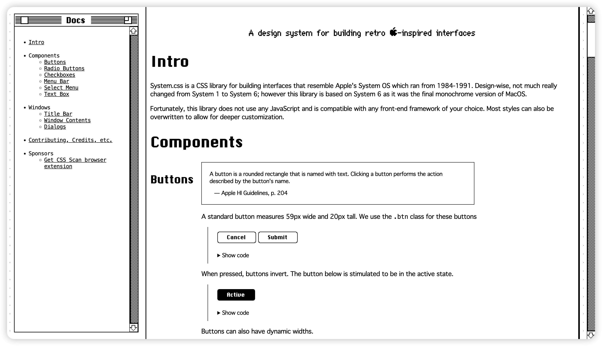

# ClassyGithub v2

> 无需部署、无需登录，把你的 GitHub 变成一个可分享的个人主页 + Gist 博客，附带四套复古主题。

**在线示例**：<https://classy-web.dnevend.workers.dev/Dnevend>

<p align="center">
  
</p>

## 特性

- **五套主题**：`default` / `nes`（8-bit 像素）/ `win95` / `mac`（System 6）/ `tui`（DOS 字符界面）。
  主题是 URL 维度 + cookie 记忆：`?theme=nes` 选一次，之后访问任意页面都是这套皮肤。
- **分享卡片**：每页页脚「分享」悬浮/点击展开，可保存一张 1200×630 的主题化分享图（带二维码），或一键分享到 X。
- **双语**：English / 中文切换，默认英文，站点可在配置里设默认语言。
- **服务端渲染**：HTML 直出，标题、OG、JSON-LD 都在首屏里，分享卡片和搜索收录都正常。
- **边缘缓存**：Workers Cache API 分级缓存（主页 5 分钟 / 文章 1 小时），冷启动 < 2s，命中 ~0.3s。
- **Gist 当 CMS**：Gist 描述写 `classy.<分类>.<标题>`，自动变成分类和标题。
- **配置即代码**：fork 本仓库，改根目录 `classy.config.json` 即可。
- **安全**：README / Gist 内容走 `rehype-sanitize` 白名单，`javascript:` 链接被丢弃。

## 快速开始

```bash
git clone https://github.com/Dnevend/classy-github.git
cd classy-github
pnpm install

# 本地开发（可选：配置 GITHUB_TOKEN 提高 API 配额）
echo 'GITHUB_TOKEN=github_pat_xxx' > apps/web/.dev.vars
pnpm dev            # http://localhost:4321
```

`GITHUB_TOKEN` 只读 public repo 即可（classic PAT 不勾任何 scope 也行）。
不配也能跑，但匿名配额是 60 次/小时，容易触发限流提示。

## 自定义配置

在你自己的 fork 里改根目录 `classy.config.json`（读的是**默认分支**，`main` / `master` / 其他都行）：

```json
{
  "theme": "default",
  "language": "en",
  "profile": {
    "repos": { "visible": true, "showCount": 6 },
    "cover": "https://picsum.photos/1024/576",
    "showFollowers": true,
    "showFollowing": true
  },
  "gists": {
    "prefix": "classy",
    "split": ".",
    "default": null,
    "type": [{ "name": "blog" }, { "name": "code" }]
  },
  "links": [
    { "title": "GitHub", "href": "https://github.com/Dnevend/classy-github" }
  ],
  "nav": {
    "extra": [{ "title": "About", "href": "https://example.com/about" }]
  },
  "seo": { "index": true }
}
```

| 字段 | 说明 |
|---|---|
| `theme` | 默认主题名（default / nes / win95 / mac / tui） |
| `language` | 默认语言 `en` / `zh`，访客可用 `?lang=` 覆盖 |
| `profile.repos.showCount` | 主页展示多少个仓库（0–100，越界会被夹紧） |
| `profile.cover` | 资料卡封面图 |
| `gists.prefix` / `split` | Gist 分类规则，默认 `classy.<type>.<title>` |
| `links` | 页脚链接（只允许 http/https） |
| `nav.extra` | 导航里追加的外链（最多 5 条，只允许 http/https） |
| `seo.index` | **是否允许搜索引擎收录你的主页**，默认 `false` |

配置写错不会把站点搞崩：每一段独立校验，坏的那段回退默认值，`links` 里坏的那条只是被丢掉。

## 主题

| 主题 | 预览 | 说明 |
|---|---|---|
| `default` |  | 干净的卡片式布局 |
| `nes` |  | NES.css + 缝合像素字体（中英统一像素字形） |
| `win95` |  | 98.css，窗口 / 任务栏 / 立体按钮 |
| `mac` |  | 手写 System 6：条纹标题栏、1px 硬阴影 |
| `tui` | — | TuiCss：DOS 蓝屏、灰色标题条、绿色按钮 |

切换方式：任意页面页脚的 `DEFAULT / NES / WIN95 / MAC / TUI`，或直接加 `?theme=nes`。
每套主题的 CSS 独立打包，访问 `default` 的访客不会下载 NES 那 279KB。

## 部署

```bash
# 1) 写入 GitHub token（只读 public repo）
cd apps/web/dist/server && ../../node_modules/.bin/wrangler secret put GITHUB_TOKEN

# 2) 构建 + 发布（仓库根目录一条命令）
pnpm deploy:web
```

生产环境是 Cloudflare Workers（`wrangler.jsonc` 已配好 Assets + KV）。
KV 命名空间 `USERS` 保存「显式开启 `seo.index` 的用户」，供 `/sitemap.xml` 使用。

## 项目结构

```
apps/web/
  src/
    pages/            5 条路由 + 404 + robots.txt + sitemap.xml
    themes/           契约（5 个槽位）+ default / nes / win95 / mac
    lib/              github 取数、markdown 管线、配置校验、边缘缓存
    middleware.ts     主题解析 + 按路由分级缓存
  wrangler.jsonc
packages/types/       GitHub 数据类型
specs/                重构计划与每个阶段的实现记录
```

## 分支

- `main`：v1（Vite + React SPA），已冻结
- `v2`：当前版本，所有改动进这里

## 许可

代码 MIT。字体与第三方样式：

- **Fusion Pixel Font**（OFL-1.1）— `public/fonts/fusion-pixel-12px-zh_hans.woff2`
- **Press Start 2P**（OFL-1.1）— `public/fonts/press-start-2p.woff2`
- **98.css**（MIT）— `apps/web/src/themes/win95/vendor/98.css`
- **NES.css**（MIT）— npm 依赖
- **TuiCss**（MIT）— `apps/web/src/themes/tui/vendor/`，字体 Perfect DOS VGA 437 自托管
