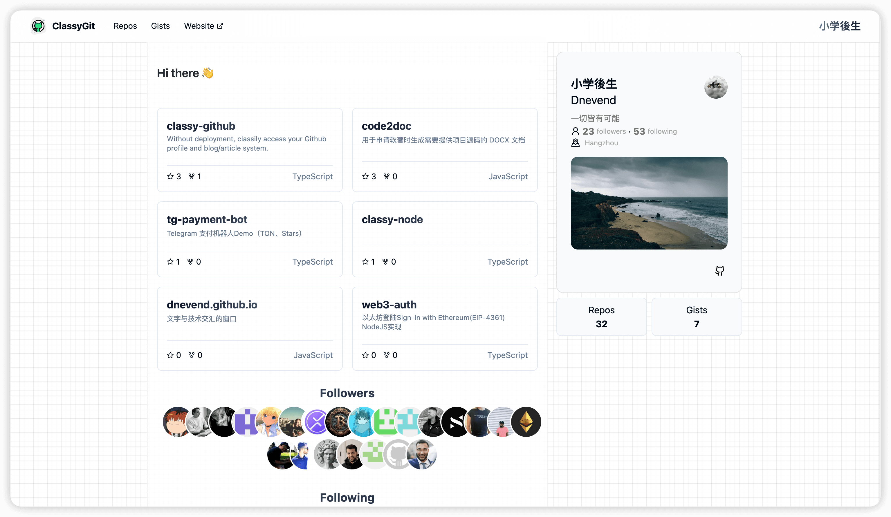
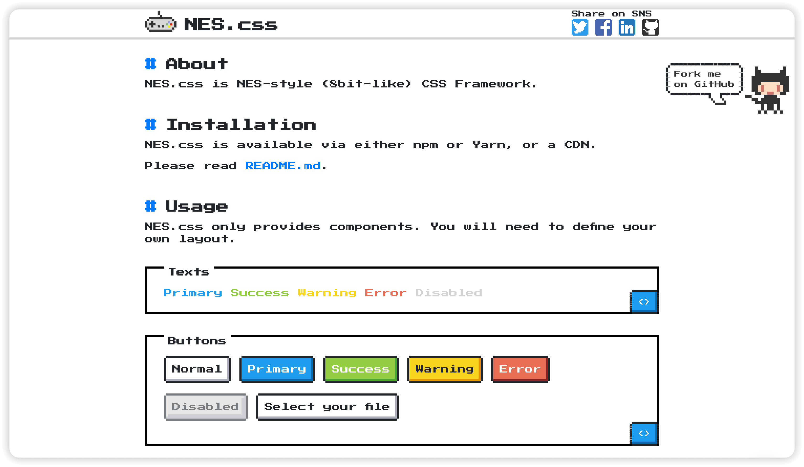
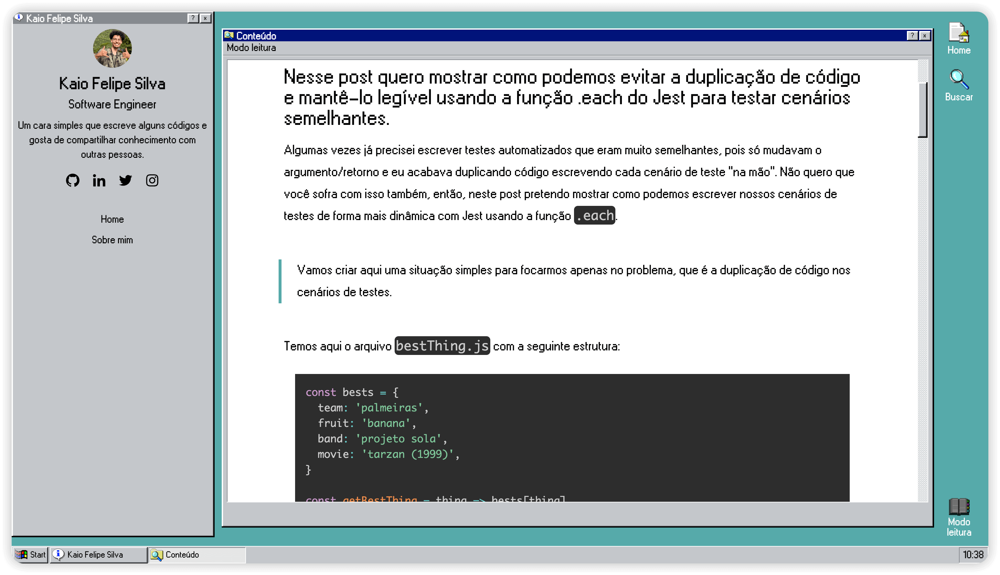

# ClassyGithub v2

> 无需部署、无需登录，把你的 GitHub 变成一个可分享的个人主页 + Gist 博客，附带四套复古主题。

**在线示例**：<https://classygit.pages.dev/Dnevend>

<p align="center">
  
</p>

## 特性

- **四套主题**：`nes`（8-bit 像素）/ `win98` / `mac`（System 6）/ `tui`（DOS 字符界面）。
  另保留已退役的 `default` 代码，旧链接 `?theme=default` 仍可用。
  主题是 URL 维度 + cookie 记忆：`?theme=nes` 选一次，之后访问任意页面都是这套皮肤。
- **分享卡片**：每页页脚「分享」悬浮/点击展开，可保存一张 1200×630 的主题化分享图（带二维码），或一键分享到 X。
- **双语**：English / 中文切换，默认英文，站点可在配置里设默认语言。
- **服务端渲染**：HTML 直出，标题、OG、JSON-LD 都在首屏里，分享卡片和搜索收录都正常。
- **边缘缓存**：Workers Cache API 分级缓存（主页 5 分钟 / 文章 1 小时），冷启动 < 2s，命中 ~0.3s。
- **Gist 当 CMS**：Gist 描述写 `classy.<分类>.<标题> #标签`，自动变成分类、标题和标签。
- **标签 / 归档 / 阅读时间**：Gists 页按标签筛选，`/<用户名>/archive` 按月归档，文章页显示预计阅读时长。
- **RSS / Atom**：`/<用户名>/rss.xml` 输出全部 Gist，自动发现链接已接进 `<head>`。
- **OG 分享图**：`/og/<用户名>.png` 输出 1200×630 的主题化社交卡片，链接预览不再只有头像。
- **最近访问**：首页记住本机最近看过的用户页（localStorage，不上传）。
- **配置即代码**：fork 本仓库，改根目录 `classy.config.json` 即可；也可以用 `/setup` 填表生成。
- **访问计数器**：页脚显示复古访客数，Durable Object 原子计数，不存 IP。
- **留言簿**：用一条公开 Gist 的评论做留言簿，零后端、零审核后台。
- **网站环**：默认开启的复古个人主页环，页脚「上一站 / 随机 / 下一站」。
- **88×31 徽章**：每人生成主题化小徽章，可放到 README、博客或友情链接。
- **安全**：README / Gist / 留言内容走 `rehype-sanitize` 白名单，`javascript:` 链接被丢弃。

## 快速开始

```bash
git clone https://github.com/Dnevend/classy-github.git
cd classy-github
pnpm install

# 本地开发（可选：配置 GITHUB_TOKEN 提高 API 配额）
echo 'GITHUB_TOKEN=github_pat_xxx' > apps/web/.dev.vars
pnpm dev            # http://localhost:4321
```

`GITHUB_TOKEN` 只读 public repo 即可（classic PAT 不勾任何 scope 也行）。
不配也能跑，但匿名配额是 60 次/小时，容易触发限流提示。

## 自定义配置

不想手写 JSON：打开 `https://classygit.pages.dev/setup?u=<你的用户名>`，
填表 → 复制 JSON → 粘进 fork 的 `classy.config.json`。页面会实时预览主题和语言。

也可以直接在你自己的 fork 里改根目录 `classy.config.json`（读的是**默认分支**，`main` / `master` / 其他都行）：

```json
{
  "owner": "your-login",
  "theme": "default",
  "language": "en",
  "profile": {
    "repos": { "visible": true, "showCount": 6 },
    "cover": "https://picsum.photos/1024/576"
  },
  "gists": {
    "prefix": "classy",
    "split": ".",
    "default": null,
    "type": [{ "name": "blog" }, { "name": "code" }]
  },
  "links": [
    { "title": "GitHub", "href": "https://github.com/Dnevend/classy-github" }
  ],
  "nav": {
    "extra": [{ "title": "About", "href": "https://example.com/about" }]
  },
  "now": {
    "books": ["《置身事内》"],
    "music": ["坂本龍一 - async"],
    "watching": []
  },
  "guestbook": { "gistId": null },
  "webring": { "enabled": true },
  "discover": { "enabled": true },
  "seo": { "index": true }
}
```

| 字段 | 说明 |
|---|---|
| `owner` | 配置归属的 GitHub 用户名。fork 后必须改成自己的；与访问者不匹配时会被当模板忽略 |
| `theme` | 默认主题名（mac / nes / win98 / tui；mac 为默认） |
| `language` | 默认语言 `en` / `zh`，访客可用 `?lang=` 覆盖 |
| `profile.repos.showCount` | 主页展示多少个仓库（0–100，越界会被夹紧） |
| `profile.cover` | 资料卡封面图 |
| `gists.prefix` / `split` | Gist 分类规则，默认 `classy.<type>.<title>` |
| `links` | 页脚链接（只允许 http/https） |
| `nav.extra` | 导航里追加的外链（最多 5 条，只允许 http/https） |
| `now` | 资料卡下方的「近况」：`books` / `music` / `watching` |
| `profile.cardUrl` | 可选，嵌入第三方统计卡图片（如 Action 生成的 SVG） |
| `guestbook.gistId` | 公开 Gist 的 ID，用它的评论做留言簿；`null` 关闭 |
| `webring.enabled` | 是否加入 ClassyGit 网站环，默认 `true` |
| `discover.enabled` | 是否允许出现在 `/random` 随机推荐，默认 `true` |
| `seo.index` | **是否允许搜索引擎收录你的主页**，默认 `false` |

配置写错不会把站点搞崩：每一段独立校验，坏的那段回退默认值，`links` 里坏的那条只是被丢掉。

**fork 后记得改 `owner`**：仓库里的 `classy.config.json` 是作者 Dnevend 的配置，
`owner` 不匹配时站点会把它当模板忽略（不会复制作者的主题/链接/webring 身份）。
直接用 `/setup?u=<你的用户名>` 生成配置最省事，它会自动写 `owner`。

## 社区功能

### 访问计数器

主页页脚会显示「第 N 位访客」。计数存在每个用户一个的 Durable Object 里，
同一个浏览器会话只记一次；不存 IP，也不做用户画像。bot / 预取请求只读不计数。

### 留言簿

1. 建一条**公开** Gist，描述写 `classy.guestbook`，文件名随意（例如 `guestbook.md`）；
2. 把 Gist ID 填进 `classy.config.json`：

```json
"guestbook": { "gistId": "9ec0af30..." }
```

3. 页面顶部会出现「留言簿」。访客在 GitHub 上给这条 Gist 留言，站点只读展示；
   站主要删留言，直接在 Gist 里删即可。留言里的图片会被剥离，避免追踪像素。

### 网站环与随机推荐

```json
"webring": { "enabled": true },
"discover": { "enabled": true }
```

- `webring`：加入 `/webring` 目录，页脚出现「← 上一站 / 🎲 / 下一站 →」。
  成员少于 3 个时页脚不显示，避免一个只有自己的环。
- `discover`：允许 `/random` 随机跳到你的主页。
- 两者默认开启；不想参加就把对应 `enabled` 设为 `false`。改配置后最多 1 小时同步到注册表（主页本身 5 分钟内刷新）。

### 88×31 徽章

访问 `/<你的用户名>` 页脚的「88×31 徽章」，或直接打开 `/badge/<用户名>`，
可以复制 HTML / Markdown 片段。徽章是纯 SVG，支持 `?theme=mac|nes|win98|tui`。

## 主题

| 主题 | 预览 | 说明 |
|---|---|---|
| `default` |  | 已退役，仅保留旧链接兼容 |
| `nes` |  | NES.css + 缝合像素字体（中英统一像素字形） |
| `win98` |  | 98.css，窗口 / 任务栏 / 立体按钮 |
| `mac` |  | 手写 System 6：条纹标题栏、1px 硬阴影 |
| `tui` | — | TuiCss：DOS 蓝屏、灰色标题条、绿色按钮 |

切换方式：任意页面页脚的 `DEFAULT / NES / WIN95 / MAC / TUI`，或直接加 `?theme=nes`。
每套主题的 CSS 独立打包，访问 `default` 的访客不会下载 NES 那 279KB。

## 部署

```bash
# 1) 写入 GitHub token（只读 public repo）
cd apps/web/dist/server && ../../node_modules/.bin/wrangler secret put GITHUB_TOKEN

# 2) 构建 + 发布（仓库根目录一条命令）
pnpm deploy:web

# 3) 更新 classygit.pages.dev 薄代理（SSR/DO 跑在 Workers，Pages 只转发）
pnpm deploy:pages
```

生产环境是 Cloudflare Workers（`wrangler.jsonc` 已配好 Assets + KV + Durable Object）。
`classygit.pages.dev` 是一层 Pages 代理，`SITE_ORIGIN` 让 canonical / OG / RSS / sitemap
统一使用这个域名；Worker 直连地址仍然可用。
KV 命名空间 `USERS` 保存可索引用户、站点注册表（webring / 随机推荐）；
Durable Object `HITS` 保存每个站点的访问计数。

## 项目结构

```
apps/web/
  src/
    pages/            用户页 / 列表 / 详情 + webring / badge / claim / guestbook
    themes/           契约（5 个槽位）+ nes / win98 / mac / tui（default 已退役）
    lib/              github 取数、markdown 管线、配置校验、站点注册表、边缘缓存
    middleware.ts     主题/语言解析 + 按路由分级缓存
  wrangler.jsonc
packages/types/       GitHub 数据类型
specs/                重构计划与每个阶段的实现记录
```

## 分支

- `main`：v1（Vite + React SPA），已冻结
- `v2`：当前版本，所有改动进这里

## 许可

代码 MIT。字体与第三方样式：

- **Fusion Pixel Font**（OFL-1.1）— `public/fonts/fusion-pixel-12px-zh_hans.woff2`
- **Press Start 2P**（OFL-1.1）— `public/fonts/press-start-2p.woff2`
- **98.css**（MIT）— `apps/web/src/themes/win95/vendor/98.css`（主题名是 `win98`）
- **NES.css**（MIT）— npm 依赖
- **TuiCss**（MIT）— `apps/web/src/themes/tui/vendor/`，字体 Perfect DOS VGA 437 自托管
