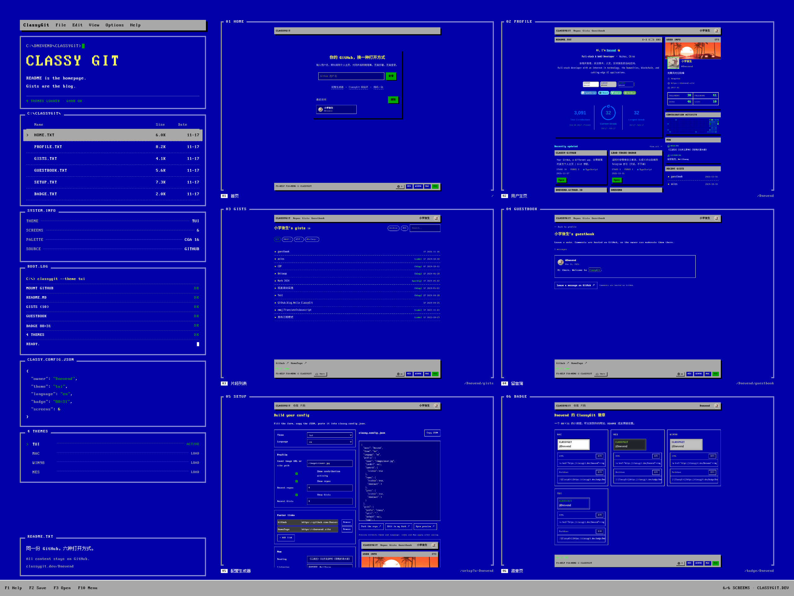

<h1 align="center">ClassyGit</h1>

<p align="center"><strong>你的 GitHub，换一种打开方式。</strong></p>

<p align="center">
  <a href="https://classygit.dev"></a>
</p>

<p align="center">
  <a href="https://classygit.dev" target="_blank"><strong>在线体验</strong></a> ·
  <a href="#三分钟开始"><strong>3 分钟开始</strong></a> ·
  <a href="./README.en.md">English</a>
</p>

<p align="center">
  <a href="https://github.com/Dnevend/classy-github/blob/main/LICENSE"></a>
  <a href="https://astro.build"></a>
  <a href="https://workers.cloudflare.com"></a>
  <a href="https://github.com/Dnevend/classy-github/pulls"></a>
  <a href="https://github.com/Dnevend/classy-github"></a>
</p>

不用部署、登录、服务器，把 GitHub 变成你的复古主页和博客。加入的站点互相链接，就像早期互联网的[友链圈](https://classygit.dev/webring)。

没有数据库、没有后台、没有账号体系，只有 GitHub 里的文件；不搬文章、不换编辑器，Gist 写完就算发布。

<table>
  <tr>
    <td width="50%" align="center">
      <a href="https://classygit.dev/Dnevend?theme=mac"></a>
      <br><sub><code>mac</code> · System 6</sub>
    </td>
    <td width="50%" align="center">
      <a href="https://classygit.dev/Dnevend?theme=nes"></a>
      <br><sub><code>nes</code> · 8-bit</sub>
    </td>
  </tr>
  <tr>
    <td width="50%" align="center">
      <a href="https://classygit.dev/Dnevend?theme=win98"></a>
      <br><sub><code>win98</code> · Windows 98</sub>
    </td>
    <td width="50%" align="center">
      <a href="https://classygit.dev/Dnevend?theme=tui"></a>
      <br><sub><code>tui</code> · DOS</sub>
    </td>
  </tr>
</table>

## 为什么是 ClassyGit

ClassyGit 不是又一个静态博客生成器。它不托管内容，也不要求你把文章搬过来：它把你已经在 GitHub 上的公开数据（个人主页 README、仓库、Gist、Gist 评论）直接渲染成你的个人主页和博客。

- **不用部署**：Fork 仓库，改一个 `classy.config.json`，最多 5 分钟生效。没有 build、CI、发布按钮。
- **不用登录**：访客打开链接就能看；站主也不用注册，配置就是 GitHub 上的一个文件。
- **不用服务器**：内容在 GitHub，页面由 Cloudflare 边缘渲染。没有 VPS、数据库、对象存储要维护。

> 你的内容不在 ClassyGit 的数据库里，它一直在你的 GitHub 上。ClassyGit 只是一层可以替换的皮肤。即使公共实例哪天停止，README、仓库、Gist 和留言仍然在 GitHub，换一个实例或自建就能继续。

## 三分钟开始

1. **Fork**：[Dnevend/classy-github](https://github.com/Dnevend/classy-github/fork)，仓库名保持 `classy-github`。
2. **填配置**：打开 [`/setup?u=你的用户名`](https://classygit.dev/setup)，填表复制 JSON 到 fork 根目录的 `classy.config.json`；把 `owner` 改成你的 GitHub 用户名。
3. **等 5 分钟**：打开 [`https://classygit.dev/你的用户名`](https://classygit.dev/)，主页最多 5 分钟刷新。

## 你能得到什么

- **README 直接当主页**：读取你的 GitHub profile README，保留 Markdown、代码高亮、相对图片；资料卡、贡献墙、最近仓库、最近 Gist、近况都会自动生成。
- **Gist 就是博客**：Gist 描述写 `classy.blog.标题 #标签`（类型名用英文字母），自动变成分类、标题和标签；支持多文件、阅读时间、按月归档和标签筛选。
- **四套复古主题**：`mac`、`nes`、`win98`、`tui` 共用同一份数据；站主在配置里设默认主题。
- **主页默认能被搜到**：主页默认允许搜索引擎收录，自动生成 Sitemap 和 Atom 订阅；搜你的名字时，Google、Bing 更容易发现这里。
- **网站环带来真实访问**：和一群独立复古站点互相链接，像早期互联网的友链圈；访客从页脚一路逛下去，你的站点也会从其他成员那里获得访问，不靠平台推荐，也没有算法。
- **留言簿**：用公开 Gist 评论当留言板，读者用 GitHub 账号就能留言。
- **分享与传播**：主题化分享卡（带二维码）、1200×630 OG 图、88×31 徽章。
- **快、干净、可替换**：服务端直出 HTML，边缘缓存；不存 IP、不做用户画像；内容留在 GitHub，随时可以换一个实例或自建。

<details>
<summary>全部页面路由</summary>

| 路由 | 你能看到 |
|---|---|
| `/<用户名>` | README、资料卡、关注数、贡献墙、最近仓库、最近 Gist、近况 |
| `/<用户名>/repos` | 全部公开仓库，搜索 + 分页 |
| `/<用户名>/repo/<仓库名>` | 仓库 README |
| `/<用户名>/gists` | 公开 Gist（最多 100 条），标签筛选 + 搜索 |
| `/<用户名>/gist/<id>` | 文章：Markdown、代码高亮、阅读时间、多文件 |
| `/<用户名>/archive` | 按月份归档（最多 100 条 Gist） |
| `/<用户名>/guestbook` | 留言簿（Gist 评论） |
| `/<用户名>/rss.xml` | Atom 订阅（最近 50 条 Gist） |
| `/webring` | 网站环目录 |
| `/random` | 随机去一个站点 |
| `/badge/<用户名>` | 88×31 徽章生成器 |
| `/setup?u=<用户名>` | 配置生成器 + 实时预览 |
| `/claim/<用户名>` | 三步认领页 + 初始配置 |

</details>

## 社区功能

ClassyGit 不只是一个主页，而是一圈可以互相串门的复古站点。网站环像早期互联网的友链圈：成员互相链接，访客能顺着一路逛下去。

| 功能 | 一句话 | 怎么开 |
|---|---|---|
| 网站环 | 独立站点互相链接、互相导流，页脚可上一站 / 随机 / 下一站 | 默认开启，`webring.enabled` |
| 随机推荐 | `/random` 随机跳到一个站点 | 默认开启，`discover.enabled` |
| 留言簿 | 用公开 Gist 的评论当留言板 | `guestbook.gistId` |
| 访客计数器 | 页脚「第 N 位访客」，不存 IP | 认领后自动 |
| 88×31 徽章 | 四主题小徽章，放 README / 友链 | `/badge/<用户名>` |

<details>
<summary>网站环和留言簿怎么开</summary>

**网站环**：早期互联网的友链圈。加入后，你的站点会出现在 `/webring` 目录，也会进入其他成员页脚的「上一站 / 下一站」；访客能从任一站点一路逛下去。不想参加就把 `enabled` 设为 `false`。

```json
{
  "webring": { "enabled": true },
  "discover": { "enabled": true }
}
```

**留言簿**：新建一条**公开** Gist，描述写 `classy.guestbook`，把 Gist ID 填进配置。访客在 GitHub 上评论，站点只读展示；站主要删留言，直接在 Gist 里删。这条 Gist 必须是公开的、且属于你，否则站点会拒绝展示。

```json
{
  "guestbook": { "gistId": "9ec0af30..." }
}
```

</details>

## 自定义配置

推荐打开 [`/setup?u=<用户名>`](https://classygit.dev/setup) 填表生成，也可以直接编辑 fork 根目录的 `classy.config.json`。仓库名必须是 `classy-github`，`owner` 必须是你的 GitHub 用户名——保留作者的 `owner` 会被当模板忽略。

常用开关：

| 想做什么 | 改哪里 |
|---|---|
| 换默认主题 | `"theme": "nes"`（可选 `mac` / `nes` / `win98` / `tui`） |
| 分享指定主题 | 在链接后加 `?theme=nes` |
| 默认中文 | `"language": "zh"` |
| 加封面图 | `"profile": { "cover": "/images/cover.jpg" }` 或任意 http(s) 图片 |
| 隐藏贡献墙 | `"profile": { "contrib": { "visible": false } }` |
| 主页显示几个仓库 / Gist | `"profile": { "repos": { "showCount": 6 }, "gists": { "showCount": 6 } }` |
| 加页脚链接 / 近况 | `"links": [{ "title": "Blog", "href": "https://…" }]`、`"now": { "books": ["…"] }` |
| 开留言簿 | `"guestbook": { "gistId": "…" }` |
| 参加网站环 / 随机推荐 | `"webring": { "enabled": true }`、`"discover": { "enabled": true }` |
| 关闭搜索引擎收录 | `"seo": { "index": false }` |
| 导航加外链 | `"nav": { "extra": [{ "title": "…", "href": "https://…" }] }`（mac / win98 主题） |

<details>
<summary>完整配置示例、字段说明和容错行为</summary>

```json
{
  "owner": "your-login",
  "theme": "mac",
  "language": "zh",
  "profile": {
    "cover": "https://example.com/cover.jpg",
    "cardUrl": null,
    "contrib": { "visible": true },
    "repos": { "visible": true, "showCount": 6 },
    "gists": { "visible": true, "showCount": 6 }
  },
  "gists": {
    "prefix": "classy",
    "split": ".",
    "default": null,
    "type": [{ "name": "blog" }, { "name": "code" }]
  },
  "links": [
    { "title": "GitHub", "href": "https://github.com/your-login" },
    { "title": "Blog", "href": "https://example.com" }
  ],
  "nav": {
    "extra": [{ "title": "About", "href": "https://example.com/about" }]
  },
  "now": {
    "books": ["《置身事内》"],
    "music": ["坂本龍一 - async"],
    "watching": []
  },
  "guestbook": { "gistId": null },
  "webring": { "enabled": true },
  "discover": { "enabled": true },
  "seo": { "index": true }
}
```

| 字段 | 默认 | 说明 |
|---|---|---|
| `owner` | `null` | 配置归属的 GitHub 用户名。与当前用户不一致时整份配置按模板忽略；为空或非法时按旧配置接受。 |
| `theme` | `mac` | 默认主题：`mac` / `nes` / `win98` / `tui`。访客没有 `?theme=` 或 cookie 时使用它。 |
| `language` | `en` | 站主默认语言：`en` / `zh`。访客没有 `?lang=`、语言 cookie，且 `Accept-Language` 里没有 `en` / `zh` 时使用。 |
| `profile.cover` | `null` | 资料卡封面图；不填时显示主题化默认横幅。接受 http(s) 图片或站内路径。 |
| `profile.cardUrl` | `null` | 「近况」卡片底部嵌入的第三方统计图，例如 Action 生成的 SVG。 |
| `profile.contrib.visible` | `true` | 是否显示贡献活跃度。 |
| `profile.repos.visible` | `true` | 是否显示主页的最近仓库。 |
| `profile.repos.showCount` | `6` | 主页显示多少个仓库，范围 0–100。 |
| `profile.gists.visible` | `true` | 是否显示主页的最近 Gist。 |
| `profile.gists.showCount` | `6` | 主页显示多少条 Gist，范围 0–100。 |
| `gists.prefix` | `classy` | Gist 描述前缀，默认规则是 `classy.blog.标题 #标签`。 |
| `gists.split` | `.` | 前缀 / 类型 / 标题之间的分隔符。 |
| `gists.default` / `gists.type` | — | 旧版兼容字段，当前版本不参与渲染。 |
| `links` | `[]` | 页脚链接，每项 `{ "title", "href" }`；只接受 http(s)，标题最多 64 字。 |
| `nav.extra` | `[]` | 导航外链，最多 5 条；当前只在 `mac` / `win98` 主题显示。 |
| `now.books` / `music` / `watching` | `[]` | 近况；各最多 8 条，每条最多 80 字。 |
| `guestbook.gistId` | `null` | 公开且属于你的 Gist ID（20–40 位十六进制）；`null` 关闭留言簿。 |
| `webring.enabled` | `true` | 是否加入网站环；成员满 3 个后页脚出现「上一站 / 随机 / 下一站」。 |
| `discover.enabled` | `true` | 是否允许出现在 `/random` 随机推荐里。 |
| `seo.index` | `true` | 是否允许搜索引擎收录主页；只对已认领站点生效，访客切到其他主题时保持 `noindex`。 |

**配置写错了会怎样**：每一段独立校验，坏的那段回退默认值，其他段照常生效；`links` 逐条校验，坏链接只丢一条；未知字段直接丢弃；主题名写错回退 `mac`，语言写错回退 `en`。

</details>

## 工作原理

```text
GitHub                          Cloudflare
┌──────────────────────┐        ┌───────────────────────────────┐
│ README / repos       │        │ Astro SSR on Workers          │
│ Gists / comments     │ ─────► │ edge cache + KV + Durable OBJ │
│ classy.config.json   │  API   │ no database for content       │
└──────────────────────┘        └──────────────┬────────────────┘
                                                │
                                                ▼
                                 classygit.dev/<username>
```

- **GitHub 是内容源，也是身份源**：README、仓库、Gist、留言都在 GitHub，ClassyGit 不复制、不托管。
- **Cloudflare 只做渲染、缓存和计数**：Workers 跑 Astro SSR，KV 存网站环 / 随机推荐 / 可索引用户，Durable Object 存访客数。
- **没有内容数据库**：即使 Cloudflare 侧的 KV / DO 全部丢失，你的主页内容也不会丢——重新访问一次就会从 GitHub 重建。

## 常见问题

<details>
<summary><strong>需要自己的服务器或域名吗？</strong></summary>

不需要。公共实例直接给你 `https://classygit.dev/<用户名>`；想绑自己的域名再自建。
</details>

<details>
<summary><strong>需要登录吗？</strong></summary>

浏览不需要；站主也不需要登录 ClassyGit，只要用 GitHub 账号放配置。留言需要 GitHub 账号，因为评论就是 Gist 评论。
</details>

<details>
<summary><strong>网站会下线吗？内容会丢吗？</strong></summary>

内容一直在 GitHub；站点只是渲染层。没有服务器可到期，没有内容数据库可丢失。即使公共实例哪天停止，README、仓库、Gist、留言仍然在 GitHub；代码是 MIT，换一个实例或自建就能继续。
</details>

<details>
<summary><strong>改了 README / 仓库，多久生效？</strong></summary>

配置（主题、链接、近况）最多 5 分钟；README、仓库和 Gist 列表最多缓存 30 分钟，用来扛住首发流量和爬虫。想立刻确认配置，从本站打开 `?preview=1`。
</details>

<details>
<summary><strong>会被 GitHub API 限流吗？</strong></summary>

生产实例用服务端 GitHub token + 边缘缓存，并在 Worker 层拦截 AI 爬虫；配额真的耗尽时优先返回 24 小时内的旧页面（`x-classy-stale`），而不是错误页。
</details>

<details>
<summary><strong>能当博客用吗？支持私有内容吗？</strong></summary>

能。公开 Gist 就是文章，支持 Markdown、代码高亮、标签、归档、阅读时长和 Atom 订阅。只读取公开数据；私有仓库和 secret Gist 不会显示。
</details>

## 开发

需要 Node 22+ 和 pnpm 9+。

```bash
git clone https://github.com/Dnevend/classy-github.git
cd classy-github
pnpm install
pnpm dev            # http://localhost:4321
```

提交改动前跑 `pnpm check`、`pnpm test` 和 `pnpm build`。欢迎 Issue 和 PR。

## 分享 ClassyGit

如果这个项目让你想重新装修自己的 GitHub，欢迎 [Star 这个仓库](https://github.com/Dnevend/classy-github)，或者把它发给那个「一直想开博客、却迟迟没动手」的朋友。也可以[分享到 X](https://twitter.com/intent/tweet?text=ClassyGit%20%E2%80%94%20%E6%8A%8A%20GitHub%20%E5%8F%98%E6%88%90%E4%B8%80%E5%BA%A7%E5%A4%8D%E5%8F%A4%E4%B8%AA%E4%BA%BA%E4%B8%BB%E9%A1%B5%20%2B%20%E5%8D%9A%E5%AE%A2%E3%80%82&url=https%3A%2F%2Fclassygit.dev)。

把徽章放进你的 README 或友链：

```md
[](https://classygit.dev/你的用户名)
```

[](https://classygit.dev/badge/Dnevend)

<details>
<summary>看看 OG 预览图</summary>


</details>

## 许可

代码以 [MIT](./LICENSE) 发布。随附字体与第三方样式遵循各自许可：Fusion Pixel Font、Press Start 2P（OFL-1.1），98.css、NES.css、TuiCss（MIT）。
