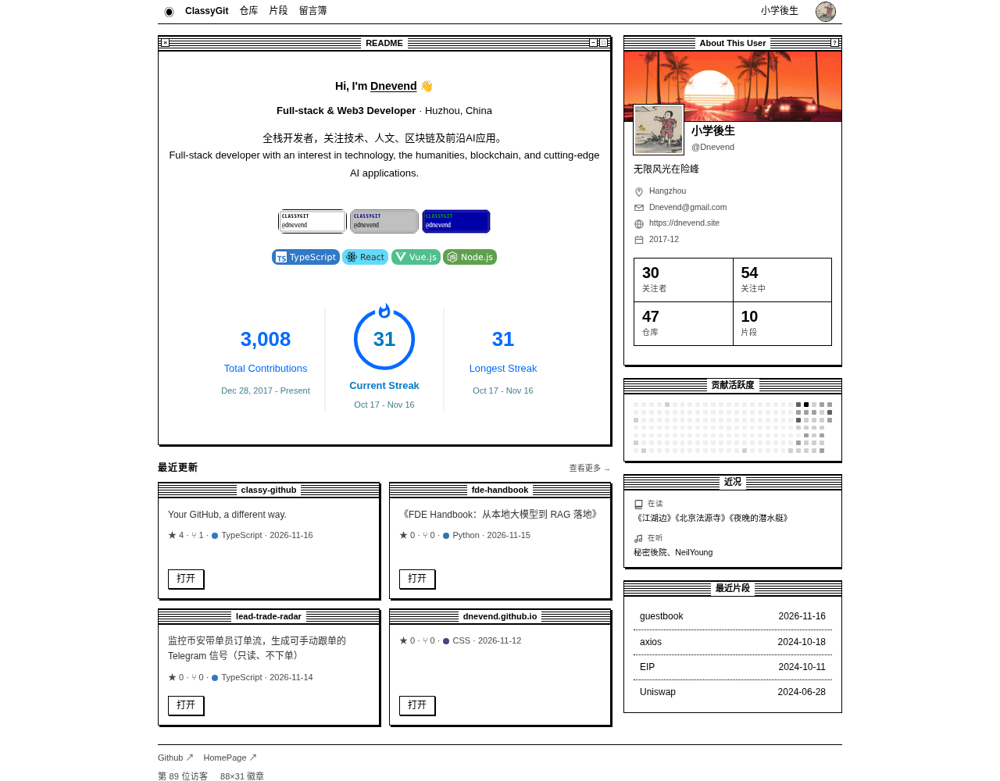
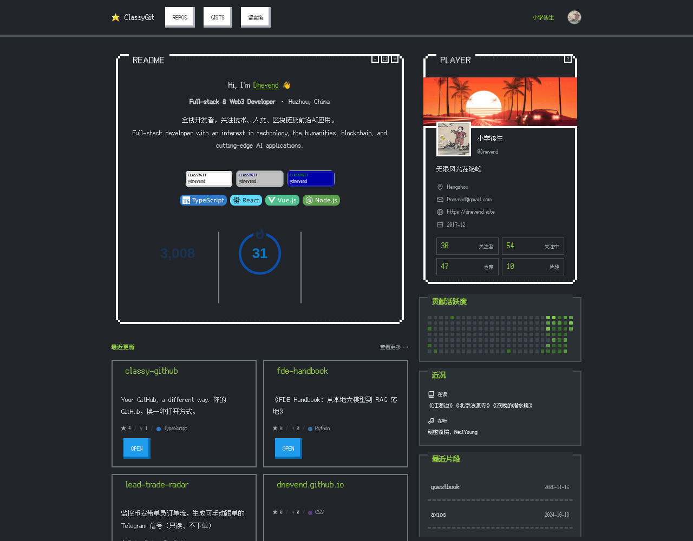
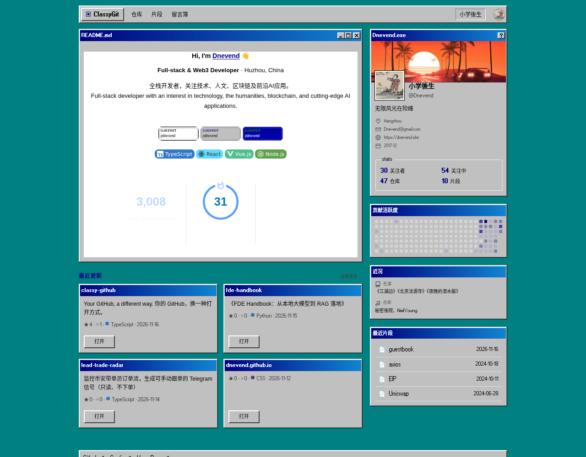

# ClassyGit

**你的 GitHub，换一种打开方式。**

不用部署、不用登录、不用买服务器：把 README、仓库和 Gist 变成一座复古个人主页 + 博客。

<p align="center">
  <a href="https://classygit.pages.dev/Dnevend"><strong>在线体验</strong></a> ·
  <a href="#三分钟开始"><strong>三分钟搭建</strong></a> ·
  <a href="https://classygit.pages.dev/setup"><strong>配置生成器</strong></a> ·
  <a href="#主题"><strong>四套主题</strong></a> ·
  <a href="https://github.com/Dnevend/classy-github"><strong>GitHub</strong></a> ·
  <a href="./README.en.md">English</a>
</p>

四套主题，同一份 GitHub 数据。点图直接打开线上对应主题：

| `mac` · System 6 | `nes` · 8-bit |
|---|---|
| [](https://classygit.pages.dev/Dnevend?theme=mac) | [](https://classygit.pages.dev/Dnevend?theme=nes) |
| **`win98` · Windows 98** | **`tui` · DOS** |
| [](https://classygit.pages.dev/Dnevend?theme=win98) | [](https://classygit.pages.dev/Dnevend?theme=tui) |

<p align="center"><sub>mac / nes / win98 / tui · 截图来自 <a href="https://classygit.pages.dev/Dnevend">Dnevend 的主页</a></sub></p>

**目录**：[为什么](#为什么是-classygit) · [开始](#三分钟开始) · [特性](#网页特性) · [主题](#主题) · [社区](#社区功能) · [配置](#自定义配置) · [FAQ](#常见问题) · [自建](#开发与自建)

## 为什么是 ClassyGit

ClassyGit 不是又一个静态博客生成器。它不托管内容，也不要求你把文章搬过来：它把你已经在 GitHub 上的公开数据——profile README、仓库、Gist、Gist 评论——直接渲染成一座个人主页 + 博客。

和 GitHub Pages 不同：不用维护一个站点项目，也不用为每篇文章构建；你改的是 GitHub 上已有的内容，ClassyGit 负责把它渲染出来。

| 不用部署 | 不用登录 | 不用买服务器 |
|---|---|---|
| Fork 仓库，改一个 `classy.config.json`，最多 5 分钟生效。没有 build、CI、发布按钮。 | 访客打开链接就能看；站主也不用注册 ClassyGit。配置就是 GitHub 上的一个文件。 | 内容在 GitHub，页面由 Cloudflare 边缘渲染。没有 VPS、数据库、对象存储要维护。 |

> **你的内容不在 ClassyGit 的数据库里，它一直在你的 GitHub 上。ClassyGit 只是一层可以替换的皮肤。**
>
> 没有服务器到期、没有数据库丢失、没有平台锁定。即使公共实例哪天停止，README、仓库、Gist 和留言仍然在 GitHub；代码是 MIT，换一个实例或自建就能继续。

运行时只有两个外部依赖：**GitHub 提供内容和身份，Cloudflare 提供计算、缓存和计数**。没有登录服务、没有需要续费的个人服务器；仓库默认不加载分析脚本，作者实例可选启用无 Cookie 的 Cloudflare Web Analytics。

**适合谁？**

- 想有自己的主页 / 博客，但不想维护服务器、域名和构建流程的人
- 已经在 GitHub 写 README、用 Gist 记笔记，想换个好看的门面的人
- 喜欢 System 6、8-bit、Windows 98、DOS 复古美学的人
- 想和别的独立站点互相串门、交换 88×31 徽章的人

## 三分钟开始

1. **先看效果**：打开 [classygit.pages.dev/Dnevend](https://classygit.pages.dev/Dnevend)，或在首页输入任意 GitHub 用户名。任何公开的 GitHub 账号都能直接生成页面，不用 fork。
2. **Fork 仓库**：[Dnevend/classy-github](https://github.com/Dnevend/classy-github/fork)。仓库名保持 `classy-github`（fork 默认就是）。
3. **生成配置**：打开 [`/setup?u=你的用户名`](https://classygit.pages.dev/setup)，填表 → 复制 JSON；或者直接编辑 fork 根目录的 `classy.config.json`。把 `owner` 改成你的 GitHub 用户名。
4. **等 5 分钟**：访问 `https://classygit.pages.dev/你的用户名`。主页最多 5 分钟刷新，不需要构建、部署或 CI。

> 普通用户不需要 `pnpm install`、不需要 Cloudflare 账号、不需要域名。只有想改代码或自己托管时，才看文末的「开发与自建」。

## 网页特性

### 页面一览

| 路由 | 你能看到 |
|---|---|
| `/<用户名>` | README、资料卡、关注数、贡献墙、最近仓库、最近 Gist、近况 |
| `/<用户名>/repos` | 全部公开仓库，搜索 + 分页 |
| `/<用户名>/repo/<仓库名>` | 仓库 README |
| `/<用户名>/gists` | 公开 Gist（最多 100 条），标签筛选 + 搜索 |
| `/<用户名>/gist/<id>` | 文章：Markdown、代码高亮、阅读时间、多文件 |
| `/<用户名>/archive` | 按月份归档（最多 100 条 Gist） |
| `/<用户名>/guestbook` | 留言簿（Gist 评论） |
| `/<用户名>/rss.xml` | Atom 订阅（最近 50 条 Gist） |
| `/webring` | 网站环目录 |
| `/random` | 随机去一个站点 |
| `/badge/<用户名>` | 88×31 徽章生成器 |
| `/setup?u=<用户名>` | 配置生成器 + 实时预览 |
| `/claim/<用户名>` | 三步认领页 + 初始配置 |

### 个人主页

- **README 直接当主页**：读取你的 GitHub profile README，保留 Markdown、代码高亮和相对图片；没有 README 时自动生成一版。
- **资料卡**：头像、名字、bio、位置、公司、邮箱、个人网站、X、加入时间；可以放自定义封面图，没有封面时显示主题化默认横幅。
- **数据一览**：followers / following / repos / gists，贡献活跃度墙按主题配色。
- **最近更新**：按更新时间展示仓库，点进去能直接看仓库 README。
- **近况**：在读 / 在听 / 在看，也可以嵌入第三方统计卡。
- **认领提示**：别人的页面会显示「把它变成你的」，点进三步认领页。

### 内容与博客

- **仓库列表**：全部公开仓库，搜索 + 分页。
- **Gist 当 CMS**：Gist 描述写 `classy.blog.标题 #标签`，自动变成分类、标题和标签；分类名用英文字母（如 `blog` / `code` / `note`），前缀和分隔符可配置。
- **标签 / 归档 / 阅读时间**：按标签筛选，按月归档，文章页估算阅读时长。
- **多文件 Gist**：每个文件独立渲染；Markdown 走同一套管线，代码用 Shiki 服务端高亮（21 种常用语言）。
- **Atom 订阅**：`/<用户名>/rss.xml` 输出最近 50 条 Gist 的 Atom 订阅，自动发现链接已接进 `<head>`。Gist 列表和归档最多读取 100 条。

### 分享与传播

- **主题化分享卡**：页脚「分享」生成一张 1200px 宽的主题化 PNG，带二维码；可保存、复制链接、一键分享到 X。分享卡会跟随当前主题。
- **OG 预览图**：`/og/<用户名>.png` 输出 1200×630 的主题化社交卡片，链接预览不再只有头像。
- **88×31 徽章**：四套主题配色，复制 HTML / Markdown 就能放到 README、博客或友情链接。
- **SEO**：服务端直出 title / description / canonical / JSON-LD；默认不收录，`seo.index: true` 才允许。默认主题页面输出 `index`，访客切到其他主题时保持 `noindex`。
- **Sitemap / Robots**：用户页只收录主动开启 `seo.index` 的；首页和网站环固定收录。

### 体验与性能

- **四套主题**：`mac`（System 6）/ `nes`（8-bit）/ `win98` / `tui`（DOS）；站主可在配置里设默认主题，访客用 `?theme=` 或页脚切换后会用 cookie 记住；每套 CSS 独立打包，只加载当前主题。
- **双语**：English / 中文；站主可设默认语言，访客用页脚切换或 `?lang=zh` 覆盖。
- **移动端**：375px 宽下四套主题都无横向溢出，主内容自动塌成单列。
- **最近访问**：首页记住本机看过的用户页（localStorage，不上传）。
- **边缘缓存**：用户主页 5 分钟 / 文章 1 小时 / 徽章与 OG 图 1 天；缓存键带主题和语言，不会把 NES 的页面发给 mac 访客。上游 5xx 或限流时回退到 24 小时内的旧页面，而不是错误页。
- **服务端渲染**：首屏就是完整 HTML，爬虫和分享预览都能直接读到内容。

### 安全与隐私

- **应用不存 IP、不做用户画像**。默认不加载分析脚本；作者实例可选启用无 Cookie 的 Cloudflare Web Analytics（由 `PUBLIC_CF_ANALYTICS_TOKEN` 控制，不配则不注入）。
- 应用只用两个功能性 cookie：记住主题和语言。
- README / Gist / 留言全部走 `rehype-sanitize` 白名单，`javascript:` 链接会被丢弃。
- 留言簿只读展示公开 Gist 评论，图片和嵌入会被剥离，避免追踪像素。
- 外链统一 `rel="noopener noreferrer"`。

## 主题

四套主题共用同一份数据，主题只决定外壳。

- 默认主题由 `classy.config.json` 的 `theme` 决定（不填是 `mac`）；旧链接 `?theme=default` 自动落到 `mac`，`?theme=win95` 落到 `win98`。
- 主题选择优先级：`?theme=` > cookie > 站主配置的 `theme` > `mac`。
- 每套主题的 CSS 独立打包；访问 `mac` 的访客不会下载 NES 那 279KB。
- 没有配置封面时，四套主题各自渲染默认横幅（棋盘格 / 像素网格 / DOS 扫描线 / Teal 桌面）。
- 分享卡、OG 图、徽章都会跟随主题配色。

## 社区功能

ClassyGit 不是一个人的主页，而是一圈可以互相串门的复古站点。

| 功能 | 一句话 | 怎么开 |
|---|---|---|
| 网站环 | 页脚「上一站 / 随机 / 下一站」，`/webring` 是目录 | 默认开启，`webring.enabled` |
| 随机推荐 | `/random` 随机跳到一个站点 | 默认开启，`discover.enabled` |
| 留言簿 | 用公开 Gist 的评论当留言板 | `guestbook.gistId` |
| 访客计数器 | 页脚「第 N 位访客」，不存 IP | 认领后自动 |
| 88×31 徽章 | 四主题小徽章，放 README / 友链 | `/badge/<用户名>` |

### 网站环与随机推荐

```json
{
  "webring": { "enabled": true },
  "discover": { "enabled": true }
}
```

- 加入后，你的站点会出现在 `/webring` 目录；页脚出现「← 上一站 / 🎲 / 下一站 →」。
- 网站环成员少于 3 个时，页脚不显示，避免一个只有自己的环。
- `discover` 允许 `/random` 随机推荐你；不想参加就把对应 `enabled` 设为 `false`。
- 改配置后主页最多 5 分钟刷新；网站环里的标题 / 主题最多 1 小时同步，成员开关在下次主页刷新时生效。

### 留言簿

用一条公开 Gist 的评论当留言簿，零后端、零审核后台：

1. 新建一条**公开** Gist，描述写 `classy.guestbook`；
2. 把 Gist ID 填进 `classy.config.json`：

```json
{
  "guestbook": { "gistId": "9ec0af30..." }
}
```

3. 页面顶部会出现「留言簿」。访客在 GitHub 上评论，站点只读展示；站主要删留言，直接在 Gist 里删。

这条 Gist 必须是公开的、且属于你，否则站点会拒绝展示；评论里的图片和嵌入会被剥离，避免追踪像素。留言需要 GitHub 账号——复用 GitHub 身份，不再多一套密码。

### 访问计数器

认领后，主页页脚会显示「第 N 位访客」。计数存在每个用户一个的 Durable Object 里，同一个标签页会话只记一次（新标签页会再计一次）；不存 IP，也不做用户画像。bot / 预取请求只读不计数，所以数字是近似值。

### 88×31 徽章

访问 `/<你的用户名>` 页脚的「88×31 徽章」，或直接打开 `/badge/<用户名>`，可以复制 HTML / Markdown 片段。徽章是纯 SVG，支持 `?theme=mac|nes|win98|tui`。

[](https://classygit.pages.dev/badge/Dnevend)

## 自定义配置

### 三种方式

| 方式 | 适合 | 入口 |
|---|---|---|
| 表单生成（推荐） | 第一次配置 | [`/setup?u=<用户名>`](https://classygit.pages.dev/setup) |
| 在线认领 | 想先看步骤 | `/claim/<用户名>` |
| 直接编辑 | 熟悉 JSON | fork 里的 `classy.config.json` |

配置生成器只生成 JSON，不会请求你的 GitHub 授权，也不会替你写仓库。

### 配置放在哪

- 仓库：`<你的用户名>/classy-github`，**仓库名必须是 `classy-github`**（fork 默认就是）。
- 文件：默认分支根目录的 `classy.config.json`；分支叫 `main`、`master` 或其他都行。
- 生效：主页最多 5 分钟刷新；不用构建、不用部署、不用 CI。
- 认领：`owner` 建议必填，且必须是你的 GitHub 用户名。fork 后如果保留作者的 `owner`，会被当模板忽略；如果 `owner` 为空或非法，会被视为旧配置并接受，不建议这样。
- 预览：`https://classygit.pages.dev/<你的用户名>?preview=1` 跳过本站缓存。

### 最小可用配置

```json
{
  "owner": "your-login",
  "theme": "mac",
  "language": "zh",
  "profile": {
    "cover": "https://example.com/cover.jpg",
    "repos": { "visible": true, "showCount": 6 },
    "gists": { "visible": true, "showCount": 6 }
  },
  "links": [
    { "title": "GitHub", "href": "https://github.com/your-login" }
  ],
  "guestbook": { "gistId": null },
  "webring": { "enabled": true },
  "discover": { "enabled": true },
  "seo": { "index": false }
}
```

> `theme` 是访客没有选择主题时的默认皮肤；想让访客直接进入某套主题，也可以分享 `?theme=nes` 链接。

### 常用开关

下面是片段，按层合并到你的 JSON 里。

| 想做什么 | 改哪里 |
|---|---|
| 换默认主题 | `"theme": "nes"`（可选 `mac` / `nes` / `win98` / `tui`） |
| 分享指定主题 | 在链接后加 `?theme=nes`（可选 `mac` / `nes` / `win98` / `tui`） |
| 默认中文 | `"language": "zh"` |
| 加封面图 | `"profile": { "cover": "https://…" }` |
| 隐藏贡献墙 | `"profile": { "contrib": { "visible": false } }` |
| 主页显示几个仓库 / Gist | `"profile": { "repos": { "showCount": 6 }, "gists": { "showCount": 6 } }` |
| 加页脚链接 | `"links": [{ "title": "Blog", "href": "https://…" }]` |
| 写近况 | `"now": { "books": ["…"], "music": ["…"], "watching": ["…"] }` |
| 开留言簿 | `"guestbook": { "gistId": "…" }` |
| 参加 / 退出网站环 | `"webring": { "enabled": true }` |
| 允许随机推荐 | `"discover": { "enabled": true }` |
| 允许搜索引擎收录 | `"seo": { "index": true }` |
| 导航加外链 | `"nav": { "extra": [{ "title": "…", "href": "https://…" }] }`（mac / win98 主题） |

> `profile.gists` 是主页右栏的「最近 Gist」预览；`gists` 是 Gist 描述规则，两者不是一回事。

### 完整配置示例

```json
{
  "owner": "your-login",
  "theme": "mac",
  "language": "zh",
  "profile": {
    "cover": "https://example.com/cover.jpg",
    "cardUrl": null,
    "contrib": {
      "visible": true
    },
    "repos": {
      "visible": true,
      "showCount": 6
    },
    "gists": {
      "visible": true,
      "showCount": 6
    }
  },
  "gists": {
    "prefix": "classy",
    "split": ".",
    "default": null,
    "type": [
      { "name": "blog" },
      { "name": "code" }
    ]
  },
  "links": [
    { "title": "GitHub", "href": "https://github.com/your-login" },
    { "title": "Blog", "href": "https://example.com" }
  ],
  "nav": {
    "extra": [
      { "title": "About", "href": "https://example.com/about" }
    ]
  },
  "now": {
    "books": ["《置身事内》"],
    "music": ["坂本龍一 - async"],
    "watching": []
  },
  "guestbook": {
    "gistId": null
  },
  "webring": {
    "enabled": true
  },
  "discover": {
    "enabled": true
  },
  "seo": {
    "index": false
  }
}
```

> `gists.default` / `gists.type` 是旧版兼容字段，当前版本不参与渲染；保留是为了不破坏旧配置。

### 字段说明

| 字段 | 默认 | 说明 |
|---|---|---|
| `owner` | `null` | 配置归属的 GitHub 用户名。与当前用户不一致时整份配置按模板忽略；为空或非法时按旧配置接受。 |
| `theme` | `mac` | 站点默认主题：`mac` / `nes` / `win98` / `tui`。访客没有 `?theme=` 或 cookie 时使用它；每套主题的 CSS 独立加载。 |
| `language` | `en` | 默认语言：`en` / `zh`。访客可用 `?lang=` 覆盖。 |
| `profile.cover` | `null` | 资料卡封面图；不填时显示主题化默认横幅。只接受 http(s)。 |
| `profile.cardUrl` | `null` | 「近况」卡片底部嵌入的第三方统计图，例如 Action 生成的 SVG。 |
| `profile.contrib.visible` | `true` | 是否显示贡献活跃度。 |
| `profile.repos.visible` | `true` | 是否显示主页的最近仓库。 |
| `profile.repos.showCount` | `6` | 主页显示多少个仓库，范围 0–100，超出会自动修正。 |
| `profile.gists.visible` | `true` | 是否显示主页的最近 Gist。 |
| `profile.gists.showCount` | `6` | 主页显示多少条 Gist，范围 0–100，超出会自动修正。 |
| `gists.prefix` | `classy` | Gist 描述前缀，默认规则是 `classy.blog.标题 #标签`（分类名用英文字母）。 |
| `gists.split` | `.` | 前缀 / 类型 / 标题之间的分隔符。 |
| `gists.default` | `null` | 兼容字段；当前版本不参与渲染。 |
| `gists.type` | `blog` / `code` | 兼容字段；当前版本不参与筛选。 |
| `links` | `[]` | 页脚链接；每项 `{ "title", "href" }`，只接受 http(s)，标题最多 64 字。 |
| `nav.extra` | `[]` | 导航外链，最多 5 条；当前只在 `mac` / `win98` 主题显示。 |
| `now.books` / `music` / `watching` | `[]` | 近况；各最多 8 条，每条最多 80 字。 |
| `guestbook.gistId` | `null` | 公开且属于你的 Gist ID（20–40 位十六进制）；`null` 关闭留言簿。 |
| `webring.enabled` | `true` | 是否加入网站环；成员满 3 个后页脚出现「上一站 / 随机 / 下一站」。 |
| `discover.enabled` | `true` | 是否允许出现在 `/random` 随机推荐里。 |
| `seo.index` | `false` | 是否允许搜索引擎收录主页；默认主题页面输出 `index`，访客切到其他主题时保持 `noindex`。 |

### 配置写错了会怎样

- 每一段独立校验：坏的那段回退默认值，其他段照常生效。
- `links` 逐条校验：坏链接只丢一条，不会让整份配置作废。
- 未知字段直接丢弃；`href` 只接受 `http(s)`。
- 主题名写错回退 `mac`；语言写错回退 `en`。
- 旧链接 `?theme=default` 自动落到 `mac`，`?theme=win95` 落到 `win98`。

## 工作原理

```text
GitHub                          Cloudflare
┌──────────────────────┐        ┌───────────────────────────────┐
│ README / repos       │        │ Astro SSR on Workers          │
│ Gists / comments     │ ─────► │ edge cache + KV + Durable OBJ │
│ classy.config.json   │  API   │ no database for content       │
└──────────────────────┘        └──────────────┬────────────────┘
                                                │
                                                ▼
                                 classygit.pages.dev/<username>
```

- **GitHub 是内容源，也是身份源**：README、仓库、Gist、留言都在 GitHub，ClassyGit 不复制、不托管。
- **Cloudflare 只做渲染、缓存和计数**：Workers 跑 Astro SSR，KV 存网站环 / 随机推荐 / 可索引用户，Durable Object 存访客数。
- **没有内容数据库**：即使 Cloudflare 侧的 KV / DO 全部丢失，你的主页内容也不会丢——重新访问一次就会从 GitHub 重建。
- **边缘缓存**：第一次请求回源 GitHub，之后走 Cloudflare 缓存；缓存键带主题和语言，避免串皮肤。
- **主题按需加载**：每套主题独立 CSS，访问 `mac` 不会下载 NES 的 279KB。

## 常见问题

**需要自己的服务器或域名吗？**
不需要。公共实例直接给你 `classygit.pages.dev/<用户名>`；想绑自己的域名再自建。

**需要登录吗？**
浏览不需要；站主也不需要登录 ClassyGit，只要用 GitHub 账号放配置。留言需要 GitHub 账号，因为评论就是 Gist 评论，复用 GitHub 身份，不再多一套密码。

**网站会下线吗？内容会丢吗？**
内容一直在 GitHub；站点只是渲染层。没有服务器可到期，没有内容数据库可丢失。即使公共实例哪天停止，README、仓库、Gist、留言仍然在 GitHub；代码是 MIT，换一个实例或自建就能继续。

**需要部署吗？**
不需要。Fork + 改 JSON，最多 5 分钟生效。`pnpm build` / `wrangler deploy` 只在自建或改代码时需要。

**会被 GitHub API 限流吗？**
生产实例用服务端 GitHub token + 边缘缓存，并在 Worker 层拦截 AI 爬虫；配额真的耗尽时优先返回 24 小时内的旧页面（`x-classy-stale`），而不是错误页。

**改了 README / 仓库，多久生效？**
配置（主题、链接、近况）最多 5 分钟；README、仓库和 Gist 列表最多缓存 30 分钟，用来扛住首发流量和爬虫。想立刻确认配置，从本站打开 `?preview=1`。

**为什么有的仓库文件页跳到了 GitHub？**
仓库文件预览只对已认领站点开放。文件树是无限深的 URL 空间，开放给任意用户会被爬虫当成入口；主页和仓库 README 不受影响。

**能当博客用吗？**
能。公开 Gist 就是文章；支持 Markdown、代码高亮、标签、归档、阅读时长和 Atom 订阅。

**支持私有内容吗？**
不支持。只读取公开数据；私有仓库和 secret Gist 不会显示。

**为什么默认不被搜索引擎收录？**
用户页是无限生成的薄内容，默认不收录，避免污染搜索。想收录就在配置里设 `seo.index: true`；默认主题页面会输出 `index`，访客切到其他主题时保持 `noindex`。

**主题和语言会记住吗？**
会。用户选择写在 cookie 里；站点默认主题由 `classy.config.json` 的 `theme` 决定；也可以用 `?theme=nes` / `?lang=zh` 临时切换或分享指定版本。

**数据隐私怎么处理？**
应用不存 IP、不做用户画像。默认不加载分析脚本；作者实例启用了无 Cookie 的 Cloudflare Web Analytics（可用 `PUBLIC_CF_ANALYTICS_TOKEN` 关闭）。应用只有主题和语言两个功能性 cookie；首页的「最近访问」只存在本机 localStorage，不上传。

## 开发与自建

<details>
<summary>本地开发、自建实例、项目结构</summary>

### 本地开发

需要 Node 22+、pnpm 9+。

```bash
git clone https://github.com/Dnevend/classy-github.git
cd classy-github
pnpm install

# 可选：配置 GITHUB_TOKEN 提高 API 配额
echo 'GITHUB_TOKEN=github_pat_xxx' > apps/web/.dev.vars
pnpm dev            # http://localhost:4321
```

`GITHUB_TOKEN` 只读 public repo 即可（classic PAT 不勾任何 scope 也行）。不配也能跑，但匿名配额是 60 次/小时，容易触发限流提示。贡献墙需要 token 才能拉到 GitHub GraphQL 数据。

### 自建实例

自建需要 Cloudflare 账号。仓库里的 `apps/web/wrangler.jsonc` 已经配好 Assets、KV 和 Durable Object，但 **KV 命名空间 ID 需要换成你自己的**：

```bash
# 1) 创建 KV 命名空间，把返回的 id 填进 wrangler.jsonc
pnpm --filter @classy/web exec wrangler kv namespace create USERS

# 2) 构建 + 发布 Worker
pnpm deploy:web

# 3) 写入 GitHub token（只读 public repo）
cd apps/web/dist/server && ../../node_modules/.bin/wrangler secret put GITHUB_TOKEN

# 4) 仅当你要维护自己的 Pages 薄代理时：先改 TARGET 和 project-name
#    apps/web/pages-proxy/_worker.js 的 TARGET
#    apps/web/package.json 的 deploy:pages project-name
cd ../../../..
pnpm deploy:pages
```

- `SITE_ORIGIN` 在 `wrangler.jsonc` 里，决定 canonical / OG / feed / sitemap 使用的域名；自建时改成你的最终地址。
- 可选：启用 Cloudflare Web Analytics。在 dashboard 的 Web Analytics 里为你的域名建一条站点并复制 token，写进 `apps/web/.env`（已在 `.gitignore`）：`echo 'PUBLIC_CF_ANALYTICS_TOKEN=...' > apps/web/.env`，再构建发布。不配则 HTML 里不会出现任何分析脚本。
- `classygit.pages.dev` 只是一层 Pages 代理，真正渲染、缓存、计数都在 Worker 里；不用 Pages 也可以直接用 Worker 地址。生产实例在 Pages 项目里配了 `CLASSY_WEB` → `classy-web` 的 Service binding；自建时可选，不配时代理会回退到 `TARGET` 的公网地址。
- `pnpm deploy:pages` 默认把 `classygit.pages.dev` 指向作者的 `classy-web.dnevend.workers.dev`；自建时请跳过这一步，或先改 `apps/web/pages-proxy/_worker.js` 的 `TARGET` 和 `apps/web/package.json` 里的 Pages `project-name`。
- 作者使用 Workers Paid（$5/月）主要是给 Shiki 语法高亮留 CPU 余量；轻度使用可以先试免费计划。

### 项目结构

```text
apps/web/
  src/pages/            用户页 / 列表 / 详情 + webring / badge / claim / setup / api
  src/themes/           契约（5 个槽位）+ mac / nes / win95（主题名 win98）/ tui
  src/lib/              GitHub 取数、Markdown 管线、配置校验、站点注册表、边缘缓存
  src/middleware.ts     主题 / 语言解析 + 按路由分级缓存
  wrangler.jsonc        Workers / KV / Durable Object 绑定
packages/types/         GitHub 数据类型
specs/                  重构计划与每个阶段的实现记录
```

### 参与贡献

欢迎 Issue 和 PR。改动前先跑：

```bash
pnpm check
pnpm test
pnpm build
```

</details>

## 分享 ClassyGit

如果这个项目让你想重新装修自己的 GitHub：

- ⭐ [Star 这个仓库](https://github.com/Dnevend/classy-github)
- 🐦 [分享到 X](https://twitter.com/intent/tweet?text=ClassyGit%20%E2%80%94%20%E4%B8%8D%E7%94%A8%E9%83%A8%E7%BD%B2%E3%80%81%E4%B8%8D%E7%94%A8%E7%99%BB%E5%BD%95%EF%BC%8C%E6%8A%8A%20GitHub%20%E5%8F%98%E6%88%90%E4%B8%80%E5%BA%A7%E5%A4%8D%E5%8F%A4%E4%B8%AA%E4%BA%BA%E4%B8%BB%E9%A1%B5%E3%80%82&url=https://github.com/Dnevend/classy-github)
- 把它发给那个「一直想开博客但迟迟没动手」的朋友

## 许可

代码 [MIT](./LICENSE)。字体与第三方样式：

- **Fusion Pixel Font**（OFL-1.1）— `apps/web/public/fonts/fusion-pixel-12px-zh_hans.woff2`
- **Press Start 2P**（OFL-1.1）— `apps/web/public/fonts/press-start-2p.woff2`
- **98.css**（MIT）— `apps/web/src/themes/win95/vendor/98.css`（主题名是 `win98`）
- **NES.css**（MIT）— npm 依赖
- **TuiCss**（MIT）— `apps/web/src/themes/tui/vendor/`，字体 Perfect DOS VGA 437 自托管
